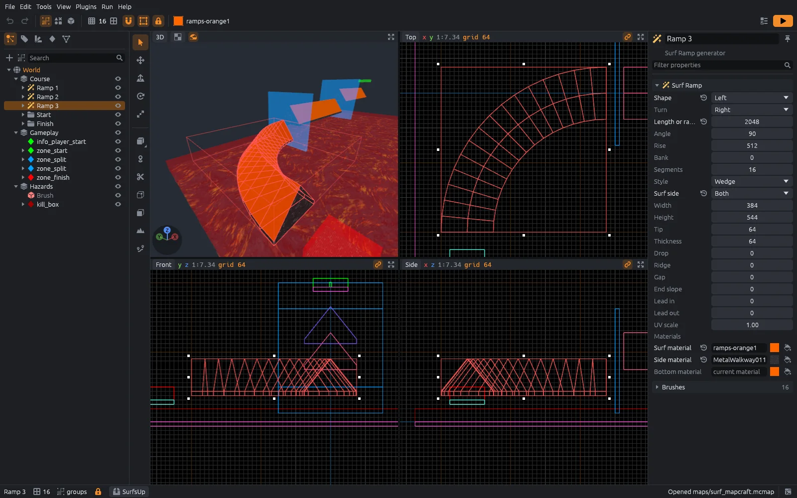

# MapCraft

A free, open-source level editor for brush-based maps, in the style of Hammer and TrenchBroom, with a Godot-style scene tree, inspector and prefabs.
It runs on Windows, macOS and Linux, and it is written in pure Rust.

**[mapcraft.site](https://mapcraft.site)** has the downloads, a [tutorial](https://mapcraft.site/tutorial/) for people who have never made a map, the [user guide](https://mapcraft.site/guide/) and the [technical docs](https://mapcraft.site/technical/).



## Games

MapCraft knows no game by itself.
Each game is an **SDK**: entity definitions (FGD), material locations, compile profiles and **plugins**.
Plugins are sandboxed WebAssembly components that teach MapCraft a game's assets and formats or add tools such as generators, and they can be written in any language that compiles to a WebAssembly component: Rust, C, C++, C#, Go, Python, JavaScript or Zig.

SDKs install from MapCraft's SDK Manager, and the first time MapCraft starts it offers them by itself.
The [MapCraftSDKs](https://github.com/bearlikelion/MapCraftSDKs) registry has SDKs for:

- **SurfsUp**: maps that load straight into SurfsUp through the MapCraft Godot addon, with surf ramp and bhop generators.
- **Counter-Strike: Source**: open and save Hammer and Hammer++ `.vmf` files, browse VPK materials and run the Valve compilers.
- **Quake**: Standard and Valve220 `.map` files, WAD textures and the ericw-tools compilers.

Anyone can host another registry, and [SDK manifests](https://mapcraft.site/technical/sdk-format.html) and the [plugin API](https://mapcraft.site/technical/plugin-api.html) explain how to add your own game.

MapCraft is in early development.

## Building

You need Rust 1.95 or newer and the `wasm32-wasip2` target for the first-party plugins.

```sh
git submodule update --init
rustup target add wasm32-wasip2
cargo xtask plugins
cargo build --release
cargo xtask ci
```

`cargo xtask plugins` builds the plugins in `plugins/` and copies each into the SDKs that use it.
[Building from source](https://mapcraft.site/technical/building.html) covers the release packages and the Godot addon.

## Contributing

Read [AGENTS.md](AGENTS.md) first: it holds the rules every change must follow, such as never crashing and keeping the code clean-room.
Run `cargo xtask ci` before every commit.

## License

MIT, see [LICENSE](LICENSE).
Third-party assets and their licenses are listed in [ATTRIBUTION.md](ATTRIBUTION.md).
