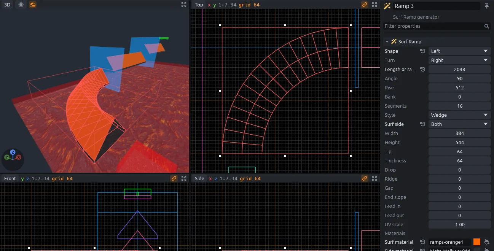
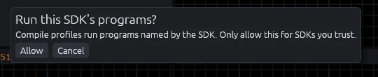

# AI agents

An AI agent such as Claude Code can build and edit your map from a prompt.
While MapCraft is open, the agent edits the open map: the views update as it works, and its changes go into the undo history like your own.

## What an agent can do

- Make brushes, entities, zones and layers, and move, rotate, copy, hollow or clip them.
- Place the SDK's generators, such as SurfsUp's surf ramps and bhop platforms.
- Give faces materials from the SDK.
- Check the map for problems, and look at the views to see its own work.
- Run a **Run** menu profile and read its output.

Ask for what you want in plain words, for example "add a curved surf ramp after the start platform" or "put a kill zone under the whole course".

## Set it up

The agent connects to MapCraft through `mapcraft-cli`, a command line program that is not in the downloads yet.

1. Build it from source: see [Building from source](building.md).
2. Register it with your agent: for Claude Code, run `claude mcp add mapcraft -- /path/to/mapcraft-cli mcp`; other agents take the same command in their MCP server settings.
3. Open a map in MapCraft, so the agent gets its SDK's entities, materials and generators.
4. Ask the agent for what you want built.

[MCP server](mcp-server.md) lists every tool the agent can call.

## Staying in control

- `Ctrl+Z` undoes the agent's edits, one step at a time, like your own.
- Nothing is saved until the agent saves, and it discards unsaved changes only when it explicitly asks to.
- The usual autosave and crash recovery cover the agent's work too.
- The first time an agent runs a profile from the **Run** menu, MapCraft asks you to allow the SDK's programs, as it does for you.
- Only programs on your own computer can reach the editor; web pages and other users cannot.

## Without the editor

With MapCraft closed, the agent works on a map file held in memory and saves it to disk itself.
A map still unsaved when the agent stops is written next to itself as `<name>.unsaved.mcmap`.
Screenshots, entity classes, materials, generators and the **Run** menu need the editor open.
