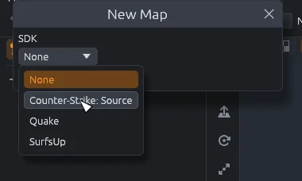
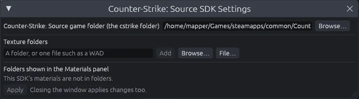
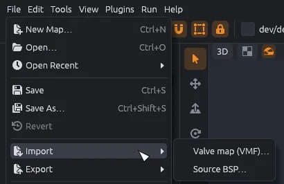
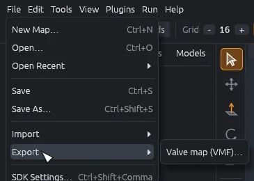
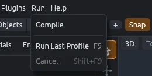

# Counter-Strike: Source

Make Counter-Strike: Source maps in MapCraft with the game's own materials, Hammer `.vmf` files, and Valve's vbsp, vvis and vrad compilers (the programs that turn a map into a playable `.bsp`).
Nothing of the game is copied into MapCraft: materials, entity definitions and compilers are read from your own install.

## Setup

1. Install Counter-Strike: Source from Steam.
   The Windows version of the game keeps its compilers (`vbsp.exe`, `vvis.exe`, `vrad.exe`) in the `bin` folder next to the `cstrike` folder.
2. Install the **Counter-Strike: Source** SDK from the **Add an SDK** window MapCraft opens on its first launch, or from the **Available** tab of **File > SDK Manager**.
3. Choose **File > New Map**, pick **Counter-Strike: Source** in the SDK list and click **Create**, unless MapCraft already started an empty map on it after the install.
4. In **File > SDK Settings**, which also opens after the install, set **Counter-Strike: Source game folder** to the `cstrike` folder, such as `.../steamapps/common/Counter-Strike Source/cstrike`.

The SDK reads the game's packages from that folder and from the `hl2` folder beside it.
It brings the game's entity definitions with it (`cstrike.fgd` and `base.fgd`; an FGD file lists every entity a game has, with its keys), since only the Windows version of the game ships them.
New brushes get `dev/dev_measuregeneric01b` at Hammer's usual texture scale of 0.25.

> [!NOTE]
> The Linux version of the game does not ship the compilers.
> Either build vbsp, vvis and vrad for Linux from the Source SDK 2013 and copy `vbsp`, `vvis`, `vrad`, `vvis_dll.so` and `vrad_dll.so` into the game's `bin/linux64` folder, beside the libraries they load, or install the Windows version of the game and Wine and use **Run > Compile with Wine**.

## Materials

The Materials tab lists the game's materials.
Each one shows a picture from the texture its `.vmt` file names, or Hammer's tool picture for tool materials such as `tools/toolsnodraw`.
Loose materials in `cstrike/materials` and `cstrike/download/materials` are listed too.

- Folders that never go on brushes are left out: `models`, `vgui`, `hud`, `console`, `particle`, `sprites` and `overviews`.
- Pictures are small, about 64 pixels on a side for the stock game, so thousands of them fit in memory.
- A material whose texture is missing, or in a format MapCraft cannot read, shows as gray; the Output panel counts them.
- The first listing after the computer starts takes about 15 seconds from a hard disk; later ones take about half a second.

> [!NOTE]
> The 3D view sizes each texture by its small picture, so it repeats more often there than in the game.
> The texture axes are still right, and they are what the `.vmf` and the compiled map use.

## Models

Props show as the game's own models in the views, read from its packages: the first body of each part, in its first skin.
The Models tab lists every model in the game's packages and in `cstrike/models`, and places the one you pick as a `prop_static`.
A model made only of animations has nothing to show and keeps its box.

## Open a .vmf

To keep working on a map from Hammer, choose **File > Import > Valve map (VMF)** and pick its `.vmf` file.
Files from Hammer, Hammer++ or a decompiler such as BSPSource all work.

- World brushes and entities come in with every key, brush entities with their brushes, and hidden objects too.
- Entities keep their outputs (the `connections` block), shown in the inspector's Outputs tab.
- The world's keys, such as `skyname`, go on the map's world, unless the open map already sets them.
- Faces keep their material and texture axes, offset, scale and rotation included.
- Material names come in lower case with forward slashes, as the game looks them up.
- Visgroups become groups named after them, nested ones as `Parent / Child`.
  An object in several visgroups goes into the first.
- Hammer groups become groups named `Group <id>`, with groups inside groups folded into the outermost one.
  An object in a Hammer group goes there rather than into its visgroup.
- A `func_instance` comes in as an entity that keeps its `file` and other keys, and goes back out the same way.
- The Output panel sums up what came in and what was skipped.

A decompiled map's own textures and models come from the files packed into its `.bsp`, which BSPSource writes into a folder beside the `.vmf`, such as `surf_x_d/` beside `surf_x_d.vmf`.
Import finds that folder and searches it for this map from then on.

When an imported map uses materials or models that no folder holds, a window lists them once they have loaded:

- **Locate Folder…** picks a folder holding them in `materials` and `models` folders (picking the `materials` folder itself works too), and searches it for this map from then on.
- **Skip** leaves them as they are: faces keep their material names, so the map still exports and compiles with them, and the window stops asking about them for this map.

The map keeps its folders and skipped names when you save it.
File names are matched in any case, as the game does on Windows.

## Export and compile

To play your map, choose **Run > Compile**.
It exports the map to a `build` folder beside it, runs vbsp, vvis and vrad on it, and copies the `.bsp` into `cstrike/maps`.
Then start the game and type `map <name>` in the console, or choose **Run > Build and play**, which compiles and then starts the game on the map.

- **Fast** runs vvis and vrad in their quick modes, for checking layout.
- **Compile** runs all three with their usual settings.
- **Final** also lights the map for HDR and with vrad's slower, cleaner `-final` sampling.
- **Compile with Wine** (Linux only) runs the Windows version's compilers through Wine.

When the compilers report a problem, such as a brush they reject, a missing material or a model a `prop_static` cannot use, the **Issues** panel opens with it, and clicking it selects the brush or entity at fault.
The exported map also carries the default value of every key an entity does not set, as Hammer writes them, since the compilers and the game never read the FGD.

To open the map in Hammer instead, choose **File > Export > Valve map (VMF)**.
It writes a `.vmf` that Hammer and Hammer++ open, with:

- the world's keys and brushes, then every entity with its keys, outputs and brushes;
- layers and groups as nested visgroups;
- every side with its plane, material, texture axes, rotation 0, and its lightmap scale and smoothing groups (16 and 0 unless the face sets them);
- displacements on world brushes, with their heights and blend alphas;
- solid and entity ids from their place in the map and side ids counted up in order, so exporting the same map twice gives the same file and a compiler's `Brush N` names a brush MapCraft can find.

If a different `.vmf` with that name is already there, it is kept beside the new one as `<name>.vmf.bak`.

## Displacements

[Displacements](displacements.md), the faces you sculpt into terrain, go both ways with their heights and their blend alphas.

- Import reads each side's `dispinfo` into a displacement of the same power, with every vertex's height along the face normal and its alpha as the blend weight.
- Export writes a `dispinfo` for every displaced face of a world brush.
- Sideways offsets, which MapCraft cannot hold, are dropped on import, and an unreadable `dispinfo` leaves its face flat; the Output panel counts both.
- Source allows displacements only on world brushes, so those on brush entities are written flat.
  So are power 1 displacements, which Source does not have; the Output panel counts them.

A Source displacement blends two textures through its material, not through MapCraft's second layer.
Give a blended face a material whose `.vmt` uses the `WorldVertexTransition` shader and names both textures, `$basetexture` and `$basetexture2`, such as the game's `nature/blendgrassdirt001a`.
MapCraft knows these materials: pick the face's own material in the Sculpt tool's Paint mode and paint its weights, which become the alphas the game blends by.
The views draw such a face with its first texture only.

A face that blends through MapCraft's second layer still exports its alphas, and the Output panel says to give it a WorldVertexTransition material.
Anti-tiling is not something Source can show, so faces that use it export plain, and the Output panel counts them.

## What is lost

Some `.vmf` content cannot come into MapCraft yet.
Import skips it and lists it in the Output panel:

- **Unreadable entity outputs**, such as one missing its delay.
- **Cameras, cordons and Hammer's view settings.**
- **Instances:** a `func_instance` stays an entity and its map is not brought in.
