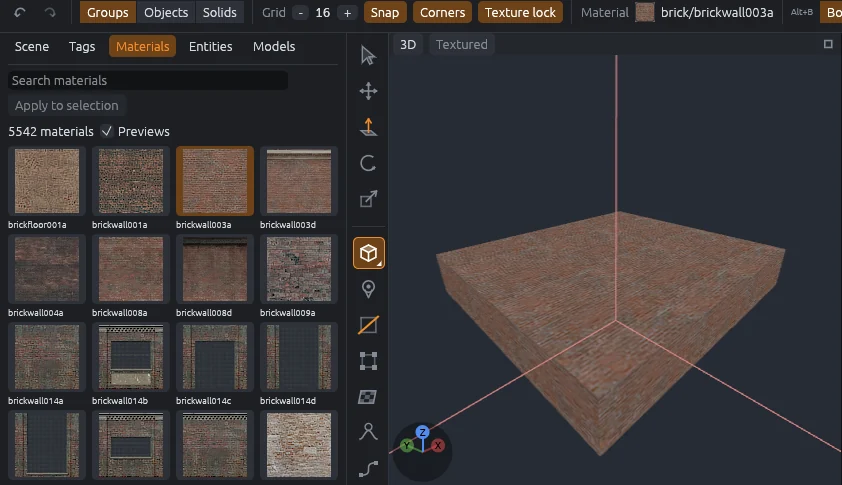

# Counter-Strike: Source

Make Counter-Strike: Source maps in MapCraft with the game's own materials, Hammer `.vmf` files, and Valve's vbsp, vvis and vrad compilers.
Nothing of the game is copied into MapCraft: materials, entity definitions and compilers are read from your own install.

## Setup

1. Install Counter-Strike: Source from Steam. The compilers (`vbsp.exe`, `vvis.exe`, `vrad.exe`) and the entity definitions (`cstrike.fgd`) live in the `bin` folder of the Windows version of the game, next to the `cstrike` folder.
2. Choose **File > New Map**, pick **Counter-Strike: Source** in the SDK list and click **Create**.
3. In **File > SDK Settings**, set **Counter-Strike: Source game folder** to the `cstrike` folder, such as `.../steamapps/common/Counter-Strike Source/cstrike`.

The SDK reads the game's packages from that folder and from the `hl2` folder beside it, and the entity definitions from `bin/cstrike.fgd`.
New brushes get `dev/dev_measuregeneric01b` at Hammer's usual texture scale of 0.25.

> [!NOTE]
> On Linux, install the Windows version of the game (in Steam, force a Proton compatibility tool for it) and install Wine, which runs the compilers.

## Materials

The Materials tab lists the game's materials, each with a picture from the texture its `.vmt` file names (Hammer's tool picture for tool materials such as `tools/toolsnodraw`).
Loose materials in `cstrike/materials` and `cstrike/download/materials` are listed too.

- Folders that never go on brushes are left out: `models`, `vgui`, `hud`, `console`, `particle`, `sprites` and `overviews`.
- Pictures are small, about 64 pixels on a side for the stock game, so thousands of them fit in memory.
- A material whose texture is missing, or in a format MapCraft cannot read, shows as gray; the Output panel counts them.
- The first listing after the computer starts takes about 15 seconds from a hard disk; later ones take about half a second.

> [!NOTE]
> The 3D view sizes each texture by its small picture, so it repeats more often there than in the game.
> The texture axes are still right, and they are what the `.vmf` and the compiled map use.

## Open a .vmf

Choose **File > Import > Valve map (VMF)** and pick a `.vmf` file from Hammer, Hammer++ or a decompiler such as BSPSource.

- World brushes and entities come in with every key, brush entities with their brushes, hidden objects too.
- Faces keep their material and texture axes, offset, scale and rotation included.
- Material names come in lower case with forward slashes, as the game looks them up.
- Visgroups become groups named after them, nested ones as `Parent / Child`; an object in several visgroups goes into the first.
- The Output panel sums up what came in and what was skipped.

## Export and compile

**File > Export > Valve map (VMF)** writes a `.vmf` that Hammer and Hammer++ open:

- the world's keys and brushes, then every entity with its keys and brushes;
- layers and groups as nested visgroups;
- every side with its plane, material, texture axes, rotation 0 and lightmap scale 16;
- ids counted up in order, so exporting the same map twice gives the same file.

If a different file is already there, it is kept beside the new one as `<name>.vmf.bak`.

**Run > Compile** exports the map to a `build` folder beside it, runs vbsp, vvis and vrad on it (through Wine on Linux and macOS), and copies the `.bsp` into `cstrike/maps`.
Start the game and type `map <name>` in the console to play it.

## What is lost

Some `.vmf` content cannot come into MapCraft yet.
Import skips it and lists it in the Output panel:

- **Displacements:** their brushes come in flat.
- **Entity outputs** (the `connections` block): triggers and buttons lose their outputs.
- **Worldspawn keys** such as `skyname`: set them again in the inspector with nothing selected.
- **Per-face lightmap scale and smoothing groups:** exports write lightmap scale 16 and no smoothing.
- **Hammer groups:** their contents come in ungrouped.
- **Cameras, cordons and Hammer's view settings.**

Export also leaves out displacements (their brushes are written flat) and entity outputs, and the Output panel says how many.
