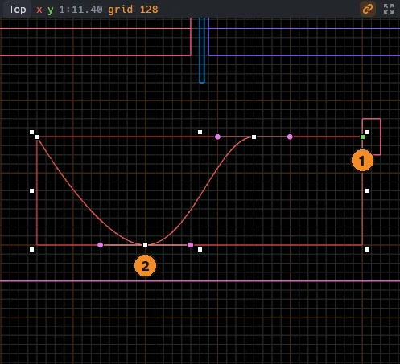
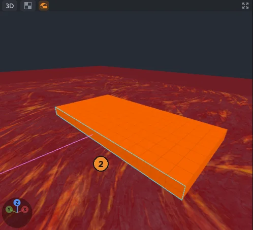

# Paths, sweeps and spins

Sweeps, spins and arrays build curved roads, rails, trims, pipes, arches and round towers from a path or an axis.
They rebuild when you change what they came from.

Brushes are always convex, so a curve is made of many straight pieces that fit together exactly.

## Paths

A path is a smooth curve through points, each with two handles, as in Blender.
It builds nothing by itself: sweeps and arrays follow it.

Press `P` for the Path tool (the last icon in the tool column), then:

1. Click in a view to add a point. The first point is green.
2. Press and drag to add a point and pull out its handles, so the curve runs smoothly through it.
3. Click the first point to close the path into a loop, or press `Enter` to finish it.

`Esc` returns to the Select tool, and `Ctrl+Z` takes back the last point.
In a 2D view a point sits at the depth of the last brush you drew; in the 3D view it sits on the ground or the face under the pointer.

### Editing a path

Select a path, then use the Select, Move or Path tool:

- Drag a point (a white square) to move it with its handles.
- Drag a handle (a dot) to bend the curve; the opposite handle turns with it. `Alt` drags one handle alone, for a sharp bend.
- `Alt` drag a point to pull fresh handles out of it, turning a corner into a smooth point.
- Click a path's line to select it, and drag the line in a 2D view to move the whole path.

Drags snap to the grid and to corners like every other drag; in the 3D view `Shift` moves points up and down.
The inspector's header shows the path's length, and its **Shape** section has a **Closed** box.
Selected paths are red with their handles; other paths are pink.

## Sweep along a path

A sweep slides a face along a path and fills the space it passes through with brushes.

1. Build the cross-section as brushes at the start of the path, for example a road deck with a curb on each side.
2. Press `Shift+F` for the Face tool and pick the faces that look along the path.
3. Choose **Tools > Curves > Sweep Along Path** (`Ctrl+Alt+S`).

Each face you sweep must be convex; split an L or U shape into several brushes.
The sweep follows the selected path, or the newest one when none is selected.

The result is a group named Sweep, selected and shown in the inspector.
The brushes you picked faces from stay as they are.

| Setting | Effect |
|---|---|
| **Segments** | Brushes per curved span; a straight span always takes one |
| **Twist** | Degrees the cross-section turns by the end of the path; on a closed path it rounds to whole turns |
| **End scale** | Size of the cross-section at the end of an open path, for tapering |

- The cross-section stays upright as the path turns, climbs and falls, and never flips, even through a loop.
- Neighboring pieces share their faces exactly, so there are no gaps.
- Textures come from the brushes you swept and continue around every bend. Line up the texture on the profile brush with the Face tool and the whole sweep follows; the ends keep the swept face's own texture.

## Spin

A spin turns faces about an axis, like a lathe, for arches, rings, round towers and spiral pieces.

1. Pick the faces with the Face tool.
2. Hover a 2D view where the axis should go and press `Ctrl+Alt+N`, or choose **Tools > Curves > Spin**.

The axis runs through the point under the pointer (or else the selection's center, or the origin).
It stands upright for a standing face, and lies level for a face lying flat, so a floor tile beside the axis swings up into an arch.

| Setting | Effect |
|---|---|
| **Angle** | Degrees to turn; 360 closes the ring |
| **Steps** | Brushes along the turn |
| **Axis** | X, Y or Z |
| **Pivot** | A point the axis runs through |

The axis is drawn through the views while the spin is selected.

## Array along a path

1. Select what to copy, such as a lamp post, and the path. Without a selected path, the newest one is used.
2. Choose **Tools > Curves > Array Along Path** (`Ctrl+Alt+D`).

Copies are spread along the path, the last one at its end, each turned to follow the path.

| Setting | Effect |
|---|---|
| **Count** | How many copies, spread evenly |
| **Spacing** | Units between copies instead of a count; 0 uses Count |
| **Turn** | **Follow** turns copies with the path; **Yaw only** turns them about Z so they stay upright |

## Live results

Sweeps, spins and arrays stay live:

- Change a setting, edit the path, or edit a picked face or copied object, and the group rebuilds in the same undo step.
- Moving a path carries its sweeps and arrays along.
- Moving the profile brushes or copied objects on their own leaves the result on the path.
- Deleting a path, profile brush or copied object leaves the result as it is, no longer following.
- Brushes inside the group are rebuilt, so edits made to them directly are lost; nothing can be dragged into the group.

**Make real** in the inspector, or **Tools > Curves > Make Real**, keeps the brushes as a plain group that no longer follows.
Copying or duplicating a curve group gives a plain group too.

> [!NOTE]
> A sweep or spin makes at most 4096 brushes, and an array at most 256 copies; larger settings are refused.

Paths and curve groups are saved in the `.mcmap` file, and the Godot addon builds their brushes like any others.
See the [file format reference](../mcmap-format.md#paths-and-curve-groups).
