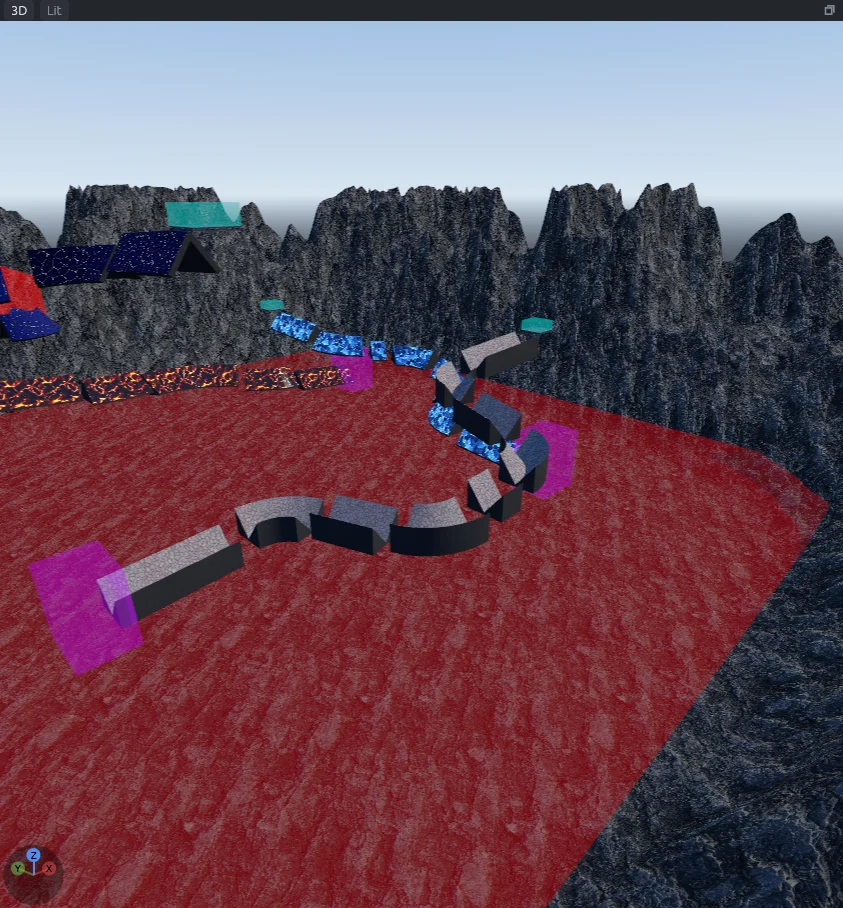

# Terrain

Turn flat floors into hills, banks and mountains, then shape them with a brush or a grayscale image.
MapCraft does this with displacements: a four-cornered face becomes a grid of points that each move up or down.

Displacements move, rotate and flip with their brushes.

## Making a displacement

1. Draw the floor with the Block tool (`B`).
2. Press `Shift+F` for the Face tool and click the faces to displace, usually the tops. Ctrl+click picks more.
3. In the **Displacement** section at the bottom of the inspector, choose a power and click **Make**.

| Power | Grid |
|---|---|
| 2 | 5 by 5 points |
| 3 | 9 by 9 points (the default) |
| 4 | 17 by 17 points |

Only faces with exactly four corners can become displacements; the status bar says when none can.
A brush with a displacement shows only its displaced faces, as Source does.

> [!WARNING]
> Switching to the Face tool with brushes selected picks every face of them. Click just the faces you want, or **Make** displaces the sides too.

### Changing the power

When a picked face is already a displacement, the button reads **Set power**.
It changes those faces to the new power and keeps their shape as closely as the new grid allows.

## Removing a displacement

Pick the faces and click **Remove** in the **Displacement** section.
They go back to flat faces.

## The Sculpt tool

Press `D`.
Point at a displacement and a yellow ring shows the brush; drag across it to sculpt.
It works in every view, and in a 2D view it shapes the topmost displacement under the pointer.

Pick a mode on the top bar, or press `1` to `5`:

| Mode | Key | Does |
|---|---|---|
| **Raise** | `1` | Pulls the surface up |
| **Lower** | `2` | Pushes the surface down |
| **Smooth** | `3` | Evens out bumps |
| **Flatten** | `4` | Levels the surface toward the height where the stroke began |
| **Noise** | `5` | Roughens the surface |

- **radius** (8 to 4096 units, 128 by default) is the brush size. It works fully at the center and fades out to the edge.
- **strength** (1 to 4096, 256 by default) is how fast it works: for Raise, Lower and Noise, the units per second at the center.
- Hold `Ctrl` while dragging to swap Raise and Lower.
- Holding the button still keeps sculpting; a single click makes one small dab.
- A stroke pauses while the pointer is off every displacement, and a click off them explains what to do in the status bar.
- A whole stroke is one undo step.

### Which faces a stroke changes

A stroke changes every visible displacement inside the ring, whichever brush it belongs to.
To limit it:

- **Pick first:** pick faces with the Face tool, then switch to Sculpt. The picks keep their cyan outline and limit every stroke until you switch tools. Picks with no displacement in them limit nothing.
- **Hide the rest:** select brushes and press `H` to hide them, or `I` to isolate the ones you want. Press `U` to show everything again.

### Seams stay sewn

Neighboring displacements stay joined.
Where two displaced faces share a point, it gets one height, so you can sculpt across seams freely.

## Heightmaps

A heightmap shapes displacements from a grayscale picture: black is low, white is high, grays in between.

1. In the Face tool, pick the displaced faces to cover. The picture spreads over all of them together.
2. In the **Displacement** section, set **black** and **white** to the heights those colors become (0 and 512 by default).
3. Click **Load** and choose a PNG, JPEG, TGA, BMP, TIFF or EXR picture.

Only the picked faces change, and their old shape is replaced.
Heights are measured out from the flat face.
On a floor, the picture's left edge is the low X side and its top is the high Y side; on a wall, its top is up.
Color pictures are read as gray, and faces that share an edge meet without a step.

