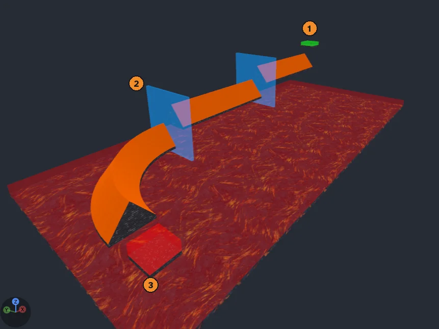
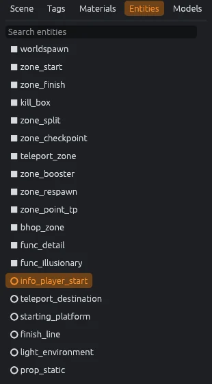
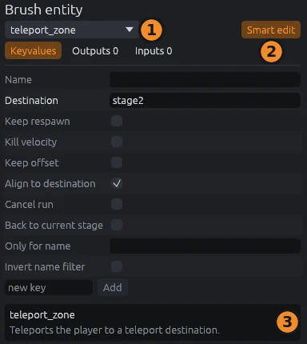
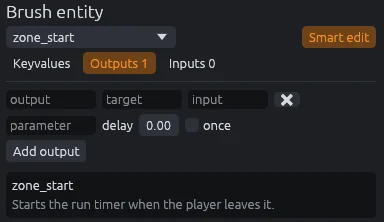
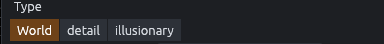
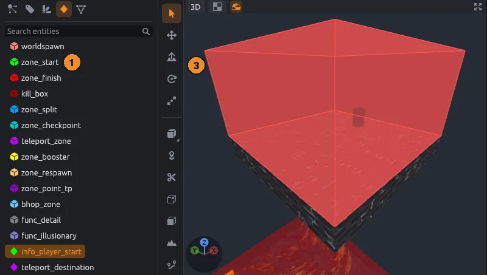
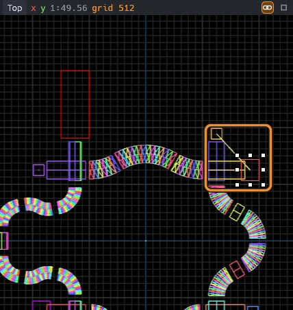

# Entities and zones

Entities are everything a game reads besides walls and floors: spawns, zones, teleport destinations, lights and props.
This page shows you how to place them, set them up and link them together.
The SDK, the package that tells MapCraft about your game, decides which entity classes exist and what settings each one has.

## Point and brush entities

There are two kinds:

- A **point entity** sits at one spot.
  It shows as a box in its class's color, or as its model when it has one (see [Models](#models)).
- A **brush entity** is made of brushes, the solid blocks you draw with the Block tool.
  Zones and triggers are brush entities, drawn see-through in the class's color.

In this sample course, the start zone is green, the split zones are blue and the finish zone is red.

## The Entities tab

The Entities tab lists every class the SDK defines.
Open it with `Ctrl+4`.
A cube icon marks brush classes and a diamond marks point classes, each in the class's color.
Type in the search box to filter, and hover a class to read what it does.

- Click a **point class** to place it with the Entity tool.
- Click a **brush class** to choose what **Tie to Entity** and **Zone from Selection** make.
  This never changes the selection.

The tab is empty when the SDK defines no classes.

## The Entity tool

1. Press `N`, or click a point class in the Entities tab.
2. Click in a view to place one.

While the tool is on, a yellow box shows where the entity will go.
The new entity gets its class's default settings, goes where new objects go (see [Organizing](organizing.md#where-new-objects-go)) and is selected.

Where it lands depends on the view:

- In the 3D view its box rests on the face under the pointer, or on the ground, with its origin snapped to the grid across the face.
  Over empty sky, or ground far off, it floats a little way out from the camera.
- In a 2D view it lands on the grid, at the depth of the last brush you drew.

The tool starts out placing `info_player_start`, the player spawn.

## Models

Point entities can show 3D models, so you see the real prop in place of a box.
MapCraft reads `.glb` and `.gltf` files, the formats Godot uses.
An entity shows a model when its class names one, or when its `model` key names a `.glb` or `.gltf` file.

- Models move, turn and scale with the entity's `origin`, `angles` (or `angle`) and `scale` keys.
- They appear at the same size and facing as they will in Godot.
- They draw with their colors and textures in the 3D view, and as wireframes in the 2D views.
- Click anywhere in a model's box to select its entity.

Models load in the background the first time a map uses them.
A model that is missing, broken or huge (over about a million triangles) shows as a plain box, and the Output panel says why.

> [!NOTE]
> Only still meshes are drawn: no animation.
> Source and Quake `.mdl` models are not drawn; their entities stay boxes.
>
> For SDK authors: a class names its model in the FGD, the file that defines the SDK's entity classes, with `studio("props/crate.glb")` or TrenchBroom's `model({ "path": "props/crate.glb" })`.
> Paths are relative to the SDK's model folders, and a leading `res://` is ignored.
> See [SDK manifests](../sdk-format.md).

### The Models tab

The Models tab lets you browse your models and drop them into the map as props.
Open it with `Ctrl+6`.

1. Click a model.
   The tab shows its triangle count and size.
2. Click in a view to place it as a prop.

Each model shows as a picture with its file name under it; hover a picture for the model's full path.
Type in the search box to filter.
**Previews**, the grid or list icon at the right of the model count, switches between the pictures and a plain list of paths, as it does in the Materials panel.

In the SurfsUp SDK the prop class is `prop_static`: its **Angles** are under **Transform**, and **Model** and **Scale** under **Properties**.
An SDK without a prop class can preview models but not place them.

> [!NOTE]
> The tab lists every model in the SDK's model folders, except those an entity class always shows, such as SurfsUp's platforms.
> Pictures are drawn the first time a model scrolls into view and kept, so they show at once next time and are redrawn only when the model file changes.
> A model that cannot be loaded shows a gray cube instead of a picture.

## The inspector

Select an entity to edit it in the inspector on the right.
An entity stores each setting as a key and a value, such as the key `targetname` holding the entity's name.
With nothing selected, the inspector shows the whole map's settings (`worldspawn`).

The top of the inspector stays in place while the rest scrolls:

1. The entity's name (`targetname`), typed straight into the header next to its icon.
   An entity without one reads **unnamed**.
2. The class dropdown turns the entity into another class of the same kind, for example a `trigger_teleport` into a `teleport_zone`, without redrawing it.
   Its settings stay; ones the new class does not know show in italics.
3. **Class help**, the question mark, shows what the class is for under the header.
4. **Smart edit**, the sliders icon (`Ctrl+Alt+E`), switches between friendly fields and the raw key and value pairs.
5. **Filter properties** shows only the rows whose name or key contains what you type.
   `Esc` or the cross clears it.

Below them the settings sit in sections.
Click a section's bar to fold it; MapCraft remembers which sections you folded.
A brush entity also shows the **Brushes** section, with its brushes' type, material and texture rows.

### Transform

A point entity's **Origin**, and its **Angles** when the class has them, come first, three fields each.
Drag a field to change it, hold `Shift` to drag slowly, or click it to type a number.

### Properties

With **Smart edit** on, each setting the class defines gets a row with a friendly name and a field that suits it:

- Numbers get fields you drag or type into.
  Number fields only take digits, a sign and a decimal point.
- Choices get a dropdown, flags and yes or no settings get checkboxes, and colors get a color picker.
- A setting that holds three numbers, such as a direction or Quake's `_sun_mangle`, gets three colored fields you drag one at a time.
  They are labeled X, Y and Z, or Yaw, Pitch and Roll in the order its description names them.
- A field that names another entity, such as a destination, suggests the names in the map.
  Its name turns orange when no entity has that name, as **Check for Problems** would report.
- Everything else is a text field.

A dimmed name means the setting is not set and shows the default; hover the name for its key and what it does.
A setting you changed shows a curved arrow after its name; click it to go back to the default.

To add a setting, type a name into **new key** and click the plus (**Add key**).
The field suggests the class's settings that are not set yet.
Settings the class does not define show in italics with a trash button that removes them.

Turn Smart edit off to see and rename the raw keys.
Typing into one field is a single undo step, and each separate edit is a step of its own.

### Editing several entities

Select several entities of the same class to edit them together.
A setting that differs between them shows its name in italics and its field reads **mixed**; what you type or pick goes to all of them.
Dragging one axis of a position, or ticking one flag, changes only that part, so each entity keeps the rest of its own value.
Entities of different classes show a note instead.

### Outputs

Outputs make one entity tell another to do something, as in Hammer.
The section shows when the class has outputs in the SDK's FGD, or when the entity already has some.
Its bar shows how many the entity has.

1. Click **Add output**.
2. Fill in the **Output name**, the **Target** entity's name, the **Input** to fire on it and a **Parameter**.
   The first three suggest what the SDK and the map offer.
3. Set a **Delay** in seconds, and tick **Once** to fire only the first time.

The trash button after **Output name** removes an output.

### Inputs

This section lists the outputs of other entities that target this entity's name (`targetname`).
It shows when the class has inputs in the FGD, or when another entity's output targets this one.
Click the pointer at the end of a row to select the entity that sends it.
An entity with no name has no inputs.

## Tie to Entity and Move to World

Brushes you draw start out as world brushes: plain solid geometry.
To turn some into a trigger, a door or another brush entity, tie them to an entity.

**Tools > Tie to Entity** (`Ctrl+T`) moves the selected world brushes into a new brush entity.

- The class is the brush class you last clicked in the Entities tab (`func_detail` until you click one).
- Brushes already in an entity are left alone.
- The new entity ends up selected.

**Tools > Move to World** (`Ctrl+Shift+W`) does the reverse: the entity goes away and its brushes stay, selected.

### Brush entity origins

A brush entity's `origin` is the point it turns about, such as a rotating door's hinge.
It shows as a small cross in the views, and as a round handle in the 2D views while the entity is selected with the Select, Move or Scale tool.

- Drag the handle in a 2D view to move the origin.
  It snaps to the grid and to corners, and the brushes stay put.
- **Tools > Center Origins** puts the origin of each selected brush entity at the middle of its brushes.
- In the Vertex tool, pick corners and choose **Set Origin to Selected Corners** from the right click menu.
  This puts the origin of the brush entity they belong to at their middle, such as on the edge a door hangs from.

Moving, turning, copying or arraying a brush entity takes its origin along with its brushes.

### Brush type

The **Type** row in the inspector's **Brushes** section switches selected brushes in one click:

- **World** makes them plain world brushes.
- **detail**, **illusionary** and **wall** tie them to `func_detail`, `func_illusionary` or `func_wall`, if the SDK has that class.

Empty entities left behind are removed, and the switch is one undo step.
In the SurfsUp SDK, `func_detail` merges into the world and `func_illusionary` is drawn but cannot be touched.

## Zone from Selection

Zones are the see-through boxes the game watches, such as start and finish timers.
**Tools > Zone from Selection** builds one that fits a platform, so you do not have to draw it by hand.

1. Click a zone class in the Entities tab, such as `zone_start`.
2. Select the platform's brushes.
3. Choose **Tools > Zone from Selection**.

The zone covers the platform's footprint and stands 256 units tall above its highest point, with the `tools/trigger` material.
It goes where new objects go and ends up selected.

> [!NOTE]
> While the brush class is still `func_detail`, MapCraft asks you to pick a trigger class first.

### SurfsUp zones

| Class | What it does in the game |
|---|---|
| `zone_start` | Starts the run timer when the player leaves it |
| `zone_finish` | Stops the run timer |
| `zone_split` | Records a split time |
| `zone_checkpoint` | A jump area: players can bunny hop inside without the floor resetting their run |
| `kill_box` | Sends the player back to their respawn point |
| `teleport_zone` | Teleports the player to a `teleport_destination` |
| `zone_point_tp` | Teleports the player to a point |
| `zone_booster` | Pushes the player |
| `zone_respawn` | Changes where the player respawns, and counts as a checkpoint on maps with no splits |
| `bhop_zone` | The same jump area as `zone_checkpoint` |

In the game, each zone becomes the matching SurfsUp zone and keeps every setting, with the same name and type.
`starting_platform` and `finish_line` place SurfsUp's own starting and landing platforms, and the views draw each with its model.
[Surf ramps and bhop](surf.md) has tips on sizing and placing zones.

## Link lines

Select an entity to see lines from it to every entity it names.
Lines follow settings that point at a target, such as a teleport zone's **Destination**, and the entity's outputs.

> [!NOTE]
> For a class the SDK does not define, the keys `target`, `parentname`, `respawn` and `landmark` count.

## Find Entities

**View > Find Entities** (`Ctrl+F`) opens the Find tab below the views.

- Type a class name or any value to list the entities that contain it, ignoring case.
- Type `key=value` to list the entities whose `key` contains `value`.
- Click a result to select it and frame it; **Select all** selects every result.

To replace text, type the new text into **replace with** and click **Replace in values**.
It changes the found text in settings and in output targets and parameters.
It works on the whole map, or with **In selection** ticked, only on the selected objects.
Replacing is one undo step, and does not work with a `key=value` search.

## Entity problems

**Tools > Check for Problems** (`Alt+P`) reports:

- A class the SDK does not define.
- A brush entity with no brushes, which **Fix** removes.
- A point entity that holds brushes.
- A target or output naming an entity that does not exist; **Fix** clears the setting or removes the output.
