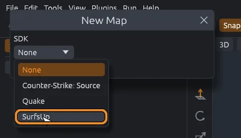
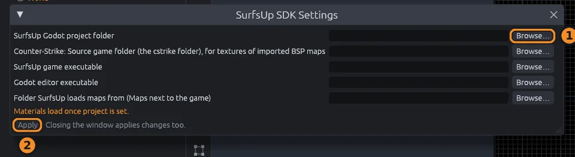
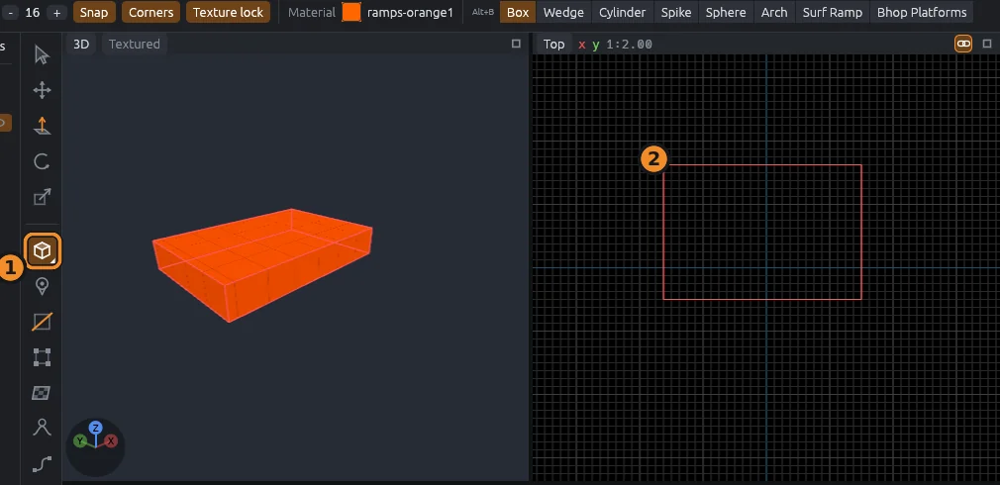
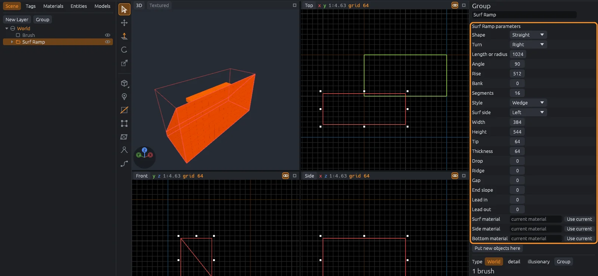
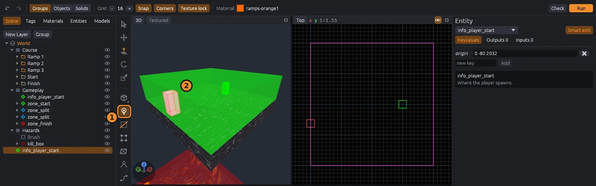
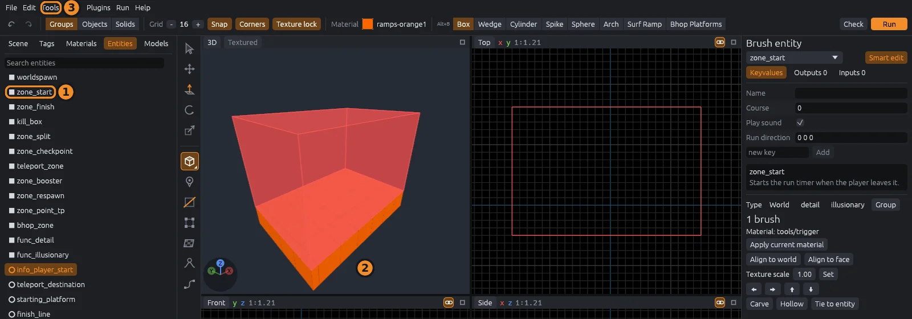
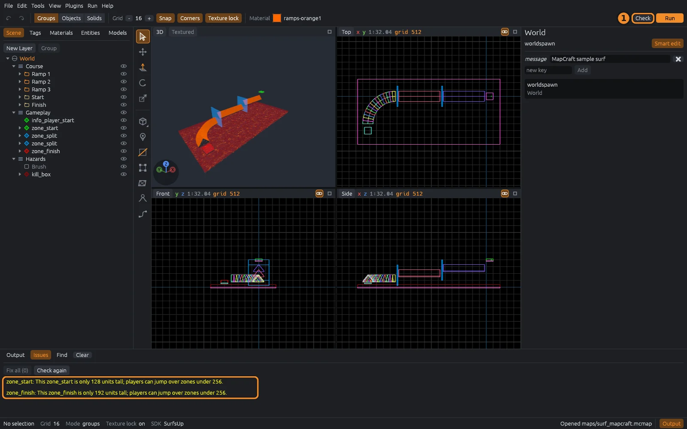
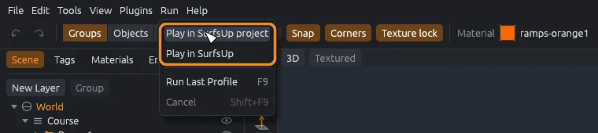

# Your first map

Build a small surf course with the SurfsUp SDK, save it, and play it in the game.
The orange numbers on each picture match the numbered steps.

## 1. Start a new map

1. Choose **File > New Map** (`Ctrl+N`).
2. Pick **SurfsUp** in the SDK list.
3. Click **Create**.

If your current map has unsaved changes, MapCraft asks whether to save them first.
When MapCraft starts without a file, it opens a new map with the SDK you used last.

## 2. Tell it where your game is

The SurfsUp SDK takes its materials from your SurfsUp Godot project.
Until it knows where that is, **SDK Settings** opens by itself.

1. Click **Browse** next to **SurfsUp Godot project folder** and pick the project folder.
2. Click **Apply**, or close the window.

A path that does not exist turns red.
The other folders are only needed to play the map and to import BSP maps; fill them in later with **File > SDK Settings** (`Ctrl+Shift+Comma`).

## 3. Draw a block

1. Press `B` for the Block tool.
2. Drag a rectangle in the Top view.

The first block is 64 units deep; later blocks match the depth of the last one you drew.
It gets the material shown in the top bar.
You can also drag in the 3D view, on the ground or on any face; hold `Shift` or `Alt` while dragging to set the height.

> [!TIP]
> To change the material, open the Materials tab (`Ctrl+3`) and click one: the selected block gets it. See [Materials](materials.md).

## 4. Place a surf ramp

With the Block tool on, the top bar lists the shapes, then **Surf Ramp** and **Bhop Platforms**.

1. Click **Surf Ramp**. A yellow ghost of the ramp follows the pointer.
2. Set **Facing** in the inspector, or click the turn icon next to it for a quarter turn.
3. Click in a view to place it.

### Change it later

The ramp keeps its settings.
Press `Q` for the Select tool, click the ramp, and change any setting in the inspector: the ramp rebuilds as you type.
[Surf ramps and bhop](surf.md) explains each setting.

## 5. Add a spawn

1. Press `N` for the Entity tool. It places `info_player_start`, the spawn point.
2. Click on top of your start platform in the 3D view.

To place something else, click its class in the Entities tab first. See [Entities and zones](entities.md).

## 6. Add start and finish zones

1. Open the Entities tab (`Ctrl+4`) and click `zone_start`.
2. Select the start platform.
3. Choose **Tools > Zone from Selection**.

The zone covers the platform's top and stands 256 units tall.
Do the same with `zone_finish` on your last platform.

## 7. Save

Press `Ctrl+S`.
The first save asks where to put the map; maps are `.mcmap` files.
**File > Save As** (`Ctrl+Shift+S`) saves a copy under a new name.
The window title starts with `*` while there are unsaved changes.

### Open it again

- **File > Open** (`Ctrl+O`) opens a map, and **File > Open Recent** lists the last ones you opened.
- Drag a `.mcmap` file from your file manager onto the MapCraft window to open it.
- Drag in any file a loaded plugin imports, such as a Quake `.map` or a Hammer `.vmf`, to add it to the open map as a new layer, as **File > Import** does.

While you drag a file over the window, it dims and says what dropping will do.
A file MapCraft cannot open leaves the map as it is and says so in the status bar.
If the open map has unsaved changes, MapCraft asks whether to save them first.

### Autosave and crash recovery

MapCraft saves a backup every 5 minutes while you have unsaved changes.
If MapCraft closes without saving, the next start asks **Recover unsaved work?**:

- **Open** loads the backup as an unsaved map.
- **Delete autosaves** throws the backups away.
- **Not now** keeps them for later.

Change the interval with **Autosave every** in **Edit > Preferences**; 0 turns autosave off.
Autosaves wait until you finish a drag, so they never catch half a move.
Saving the map, or quitting normally, deletes its autosave.
Autosaves live in the `autosave` folder of MapCraft's data folder: `~/.local/share/mapcraft/autosave` on Linux, `%LOCALAPPDATA%\mapcraft\autosave` on Windows.
Each map gets its own autosave, named for the map and its folder, so two maps called `level.mcmap` in different projects never overwrite each other's.
Each running MapCraft keeps its own autosaves too, so a second window never offers back or deletes the first one's.

### Backups and Revert

Each save first copies the file it replaces into a `backups` folder beside the map: `level.1.mcmap` is the version before the last save, `level.2.mcmap` the one before that.
**Keep backups** in **Edit > Preferences** sets how many are kept (3 to start with); 0 turns them off.
Saving a map that has not changed since its last backup makes no new one.
The `backups` folder holds a `.gdignore` file, so Godot does not import the copies as scenes.
Open a backup like any map to get an earlier version back.

**File > Revert** throws away unsaved changes and opens the saved map again, after asking.
**File > Reload Assets** (`F5`) rereads the SDK's entity definitions, materials, models and prefabs from disk, keeping the map, the selection, the undo history and the current material.
Use it after editing an FGD or a texture with the map open.

## 8. Check for problems

Press `Alt+P`, or click **Check** (the checklist) at the right of the top bar.
The Issues tab opens below the views: errors in red, warnings in yellow.

- Click an issue to select the object and look at it.
- **Fix** (the wrench on an issue's row) repairs one issue, and **Fix all** repairs every one it can, as one undo step.
- **Check again** runs the checks once more.

## 9. Play it

Open the **Run** menu, or click **Run** (the orange play button) at the right of the top bar, and pick a profile:

- **Play in SurfsUp project** runs the map in your SurfsUp Godot project.
- **Play in SurfsUp** runs it in the installed game.

Running saves the map first.
The first time, MapCraft asks **Run this SDK's programs?**; click **Allow** if you trust the SDK.
Progress shows in the Output panel.
`F9` runs the last profile again, and `Shift+F9` stops it.

Both profiles need the MapCraft addon in the game and a few more folders in SDK Settings: see [Play it in Godot](godot.md).

## Where next

- [Getting around](views.md): fly the 3D camera, maximize a view, set the grid.
- [Surf ramps and bhop](surf.md): curves, spirals and bhop platforms.
- [Organizing](organizing.md): groups, layers and the scene tree.
- [Import a BSP map](importing-bsp.md): zone an existing Counter-Strike: Source surf map.
