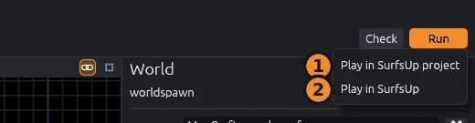

# Play it in Godot

The MapCraft addon loads `.mcmap` maps in games made with Godot 4.4 and newer.
For SurfsUp, the **Run** menu copies your map into the game and starts it.

## Install the addon

1. Download `MapCraft-godot-addon.zip` from the [latest MapCraft release](https://github.com/bearlikelion/MapCraft/releases/latest).
2. Unzip it into your Godot project's folder, so the addon lands in `addons/mapcraft`.
3. Open the project in the Godot editor once, so Godot registers the addon.

To build the addon yourself, see [Godot addon](../../godot/README.md#building).

## Point MapCraft at your game

Open **File > SDK Settings** and fill in the paths for the way you want to play:

1. **Play in the SurfsUp project**: the SurfsUp Godot project folder and the Godot editor executable.
2. **Play in the SurfsUp game**: the SurfsUp game executable and the folder SurfsUp loads maps from (the `Maps` folder next to the game).

## Play your map

Open the **Run** menu, or click the **Run** button at the top right, and pick a profile:

| Profile | What it does | Needs |
|---|---|---|
| **Play in SurfsUp project** | Copies the map into the project's `Maps` folder and runs the project in Godot | Project folder, Godot editor |
| **Play in SurfsUp** | Copies the map into the game's `Maps` folder and starts the game | Maps folder, SurfsUp game executable |

SurfsUp loads `.mcmap` files straight from its `Maps` folder and starts the map with `+map <map name>`, so there is no import or pack step.
`F9` plays the same way again.
See [Compile profiles](sdks-and-plugins.md#compile-profiles) for the Output panel and the trust prompt.

## Before you play

> [!WARNING]
> - The project or game needs the MapCraft addon: a game exported before the addon was added cannot load `.mcmap` files.
> - Materials, textures and prop models are paths into the game, so the game must have them at the same paths.
> - Only the map file is copied, so make prefabs local first; see [Prefabs](prefabs.md#prefabs-in-godot).
> - Turn cordons off first, or the game only gets what touches them.

## Maps as scenes

This section is for people making their own Godot game.
Every `.mcmap` file in a project imports as a scene that you instance, open or load like a `.tscn`.
The scene uses only Godot's built-in nodes, so the game needs neither the addon nor any script to load it.

- World brushes become one mesh, with a surface per material, and one collision body.
- Faces with `tools/` materials (`tools/nodraw`, `tools/clip`, `tools/trigger`) collide but are not drawn.
- Point entities become `Marker3D` nodes and brush entities `Area3D` nodes, unless the entity map says otherwise, and their key values become metadata.
- Props such as SurfsUp's `prop_static` place the model their `model` key names; see [Models](entities.md#models).
- Prefab instances load the prefab's `.mcmap` as a scene instance.
- Everything outside an active [cordon](organizing.md#cordons) is left out.

A face's material is found by its name under the material root: first `<name>.tres`, `.res` or `.material`, then an image (`png`, `jpg`, `webp`, `tga`, `bmp`).

## Anti-tiling

A face whose `anti_tile` attribute is `macro` draws its texture under gentle light and dark patches a few meters across, so a long ramp or wall stops showing the same tile over and over.
A face set to `hex` draws the same patches over hex tiling: the texture breaks into hexagons about one repeat across, each shifted and turned at random and blended into its neighbors.
Hex tiling reads the albedo and normal maps three times where a plain face reads them once; the other maps are still read once.
MapCraft's Textured and Lit views draw the same patches and tiles in the same places, so the editor shows what the game will, except on a material with a UV scale, which the views do not show yet, or a UV offset; their tiles sit elsewhere in the game.
A face whose material, or a blend's second material, uses a Nearest filter draws `hex` as `macro`, since blended hexagons of big texels read as double images, and the views do the same.
Inside a prefab, the game places the patches by the prefab's own origin, so they repeat with each copy and differ from the views.
AI agents set it with the `face_texture` tool; see [MCP server](../mcp-server.md).

## Blended terrain

A displacement that [blends a second material](displacements.md#blending-textures) imports with each vertex's share of it in the vertex color's alpha, and the addon's shader mixes the two materials by it the same way MapCraft's views do, brighter parts of each texture showing through first.
Each material keeps its own texture size, so the second material tiles in the game as it does in the views.
Faces with the same pair of materials share one mesh surface, named like `rock|grass`.
A displaced face whose `blend_material` is empty, its own material or a `tools/` material imports with one material, as MapCraft draws it.
Godot's Output panel warns when the second material uses a different texture filter group from the face's own, since the blend draws both with the face's filter.

## Shader wrappers

For anti-tiling and blends, the addon wraps the face's material in one of its shaders in `addons/mapcraft/shaders`, so a game needs that folder too; an older addon without it draws these faces plain.
Only a plain `StandardMaterial3D` with Godot's default modes can be wrapped: per-pixel shading, back-face culling, Mix blending, Burley diffuse, Schlick GGX specular and texture repeat, with no transparency and no features other than normal and ambient occlusion maps.
A blend needs both of its materials to qualify.
Any other material draws as it is, without its blend or anti-tiling, and Godot's Output panel names the reason:

- `not found`, for a second material missing from the material root;
- the material's class, such as `ShaderMaterial`;
- a mode: `unshaded`, `per-vertex shading`, `cull mode`, `transparency`, `blend mode`, `depth draw`, `diffuse mode`, `specular mode`, `billboard`, `distance fade`, `proximity fade`, `grow` or `no texture repeat`;
- a feature: `emission`, `rim`, `clearcoat`, `anisotropy`, `heightmap`, `subsurface scattering`, `transmittance`, `backlight`, `refraction` or `detail`;
- a flag: `triplanar`, `vertex color`, `forced sRGB`, `ambient occlusion on UV2`, `no depth test`, `no shadows`, `no ambient light`, `no fog`, `shadow to opacity`, `point size`, `fixed size`, `particle trails` or `MSDF`.

The wrapper copies the material's albedo, UV scale and offset, roughness, metallic, specular, normal and ambient occlusion maps and next pass.
It keeps the material's texture filter: Nearest stays pixelated, Nearest Mipmap and Nearest Mipmap Anisotropic stay pixelated with mipmaps, and every other filter draws smooth with mipmaps.
Anisotropic filtering is not kept.
The copy is built into the imported scene, so after changing a material that anti-tiled or blended faces use, reimport the map.
Each wrapper shader compiles the first time a map uses it, which a game can move to its loading screen by loading the six shaders there.

## Godot materials in the views

MapCraft reads each material's `.tres` to draw it in the views as the game does:

- A material's UV scale (`uv1_scale`) tiles its texture as densely in the views as in the game.
- A triplanar material's UV scale counts in world space, so the views keep such a material at its own texture size.
- A material's UV offset (`uv1_offset`) is not shown: the views tile every texture from offset 0, so a material with an offset sits shifted against the game.
- A material with a Nearest, Nearest Mipmap or Nearest Mipmap Anisotropic texture filter draws pixelated.
- A material the shader wrappers cannot take, for one of the reasons above, cannot be a blend layer, so the Sculpt tool's Paint mode refuses it.

## Import options

Select the `.mcmap` in Godot's FileSystem dock, change these in the Import dock, then click **Reimport**:

| Option | Default | Effect |
|---|---|---|
| **Units Per Meter** | 39.37 | Map units per Godot meter |
| **Material Root** | `res://Assets/Textures` | Where material names are looked up |
| **Entity Map** | empty | What each entity class becomes; empty uses the addon's map for the map's SDK, such as `sdks/surfsup.tres` |
| **Collision** | on | Builds collision |
| **Trimesh Collision** | off | The whole world collides as one triangle mesh instead of one shape per brush |

> [!TIP]
> Use Trimesh Collision for surf maps: seams between the pieces of a curved ramp can catch players when each brush collides on its own.
> The SurfsUp entity map turns it on for every SurfsUp map.

Faces hidden between touching brushes, such as the joins between ramp pieces, are left out of the meshes and of trimesh collision, so they cost nothing to draw and leave no seams.
Collision per brush still uses whole brushes.

The addon ships the SurfsUp entity map, so SurfsUp maps need no setup: the player start becomes the `SpawnPoint`, zones become `Area3D` nodes tagged `sdk_zone`, `func_detail` merges into the world, and `prop_static` places its model.
Props get no collision of their own; give the model collision in its Godot import settings when players should hit it.

## Load maps while the game runs

Games can load maps from user folders or downloads, with no import step:

- A `MapCraftMap` node builds a map while the game runs: set **Map File** and call `build()`, or leave **Build On Ready** on.
  Building first removes the node's children, and `clear()` does only that.
  It has the importer's settings and emits `entity_built(node, classname, properties)` for each entity, so the game can finish it off.
- Godot's `load()` turns any `.mcmap` path, inside or outside the project, into a scene the same way the importer does.

Entity maps, the sky and sun entity, metadata types and the rest are in the technical [Godot addon](../../godot/README.md) page.
