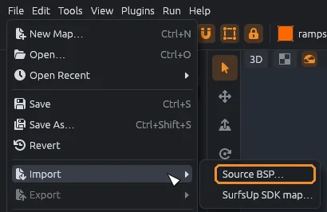
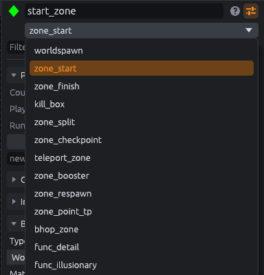

# Import a BSP map

Import a compiled Source map, such as a Counter-Strike: Source surf map, to zone it for SurfsUp.
A compiled map is the `.bsp` file the game plays, so you can bring in maps whose source files you do not have.

## Before you import

- Use an SDK that loads the Source BSP plugin, such as SurfsUp or Counter-Strike: Source.
  Without one, **File > Import** is grayed out.
- For the map's stock textures, set **Counter-Strike: Source game folder** (the `cstrike` folder) in **File > SDK Settings**.

MapCraft then reads the game's packages from that folder and from the `hl2` folder beside it.
Textures packed into the map itself load without it.

## Import

Choose **File > Import > Source BSP** and pick a `.bsp` file.

- Everything goes into a new layer named after the file, as one undo step, and the views frame it.
- The Output panel (`Ctrl+5`) sums up what came in: world brushes and how many are ramps, entities, brush entities, static props, dropped brushes, skipped displacements, and how many textures came from the map, from the game or were missing.
- When textures are missing because the Counter-Strike: Source folder is not set, it says so.

## What comes in

- **Versions:** BSP versions 19 to 21 (Counter-Strike: Source, Half-Life 2, Garry's Mod).
  Other versions are refused with a message naming the version.
  Compressed (LZMA) lumps are read.
- **Brushes:** rebuilt as solids from the brush planes the compiler kept, not as compiled faces, with their materials and texture alignment.
  Sides with no texture get `tools/toolsnodraw`.
- **Brush entities:** their brushes, placed by the entity's origin and angles, with every key except `model`.
- **Point entities:** with all their keys.
- **Static props:** as `prop_static` point entities with `model`, `origin`, `angles` and `skin`.
- **Materials:** faces keep their Source material names (lower case, without `materials/`), and patched cubemap copies go back to their base material.

Pictures come from the map's own packed files first, then from the game's packages, shrunk to fit in memory.
They are saved as PNG files in the `materials` folder of MapCraft's data folder (`~/.local/share/mapcraft/materials` on Linux), so they show in the Materials tab in later sessions too.

### How the layer is sorted

The layer follows the tree SurfsUp's SourceGD importer builds, so a map looks the same in MapCraft and in the game.
Empty groups are left out.

| Group | Holds |
|---|---|
| World | World brushes with a face the game draws |
| Skybox3D | Brushes and entities in the 3D skybox, the part of the map `sky_camera` sees |
| BrushCollision | World brushes made only of tool materials, such as clips, nodraw and skybox walls; starts hidden |
| LadderCollision | Ladder brushes; starts hidden |
| SourceEntities | Triggers, brush entities, teleport destinations and every other entity |
| Props | `prop_` entities, static props included |
| SourceEnvironment | Lights, `env_sun`, fog, tonemap and shadow controllers |

Counter-Strike's spawns become one `info_player_start` at the top of the layer.
It stands where SurfsUp spawns the player: the teleport destination named like the map's start (`td_mapstart`, `map_start`, `s1_start` and so on), or else the first spawn in the map.

Faces of visible brushes that the game never draws are often `tools/toolsnodraw`, which walls off the inside of a compiled map.
Turn off **View > Show Nodraw** to see past them.

## Limits

- Displacements are skipped.
- Brushes with no volume, and brushes with more than 2048 sides, are dropped.
- Overlays are not read.
- Models are not drawn: props are only points.
- Textures that were not found show as MapCraft's missing texture checkerboard.
- Godot looks for materials in its own material folder, not in MapCraft's data folder.
  To see the textures in Godot, copy the PNG files from there into that folder, keeping their subfolders.

## Zone a CS:S surf map for SurfsUp

Zones are the areas SurfsUp acts on, such as the start, the finish and stage teleports.
Importing a `.bsp` while the map uses the SurfsUp SDK converts it to SurfsUp as it comes in, by the rules in the SDK's `convert/cstrike.toml` (see [SDK manifests](../sdk-format.md#converting-maps)):

- one `info_player_start` stands in for Counter-Strike's spawns;
- `trigger_teleport` becomes `teleport_zone`, its `target` the zone's destination, and `info_teleport_destination` becomes `teleport_destination`;
- `trigger_push` becomes `zone_booster` and `trigger_hurt` becomes `kill_box`;
- `func_wall` and `func_brush` join the world, so they stay solid and visible;
- buy zones, bomb targets and other Counter-Strike game modes are removed.

The status line counts what changed; undo once to keep the map as it came.
A map already open in the Counter-Strike: Source SDK converts the same way from **File > Switch SDK…** with **Convert** beside SurfsUp.

What is left is done by hand:

1. Save the map as a `.mcmap`.
2. Switch to **Objects** (`Alt+2`) or **Solids** (`Alt+3`), since in Groups mode a click selects a whole import group.
3. **Start and finish:** CS:S surf maps keep these in the server's timer, not in the map.
   Click `zone_start` in the Entities tab, select the start platform and choose **Tools > Zone from Selection**.
   Do the same with `zone_finish`.
4. Run **Tools > Check for Problems** (`Alt+P`) and fix what is left; it lists every class the SurfsUp SDK does not define.

> [!NOTE]
> SurfsUp maps collide as one triangle mesh in Godot, so seams between ramp brushes cannot catch players; see [Play it in Godot](godot.md#import-options).
> [Entities and zones](entities.md) covers the inspector and Zone from Selection in more detail.
