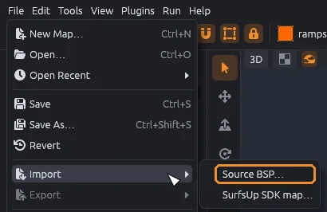
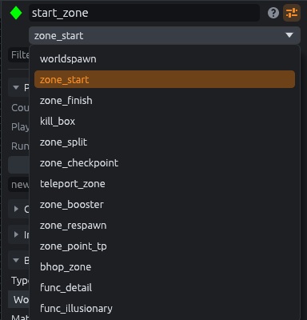

# Import a BSP map

Import a compiled Source map, such as a Counter-Strike: Source surf map, to zone it for SurfsUp.
A compiled map is the `.bsp` file the game plays, so you can bring in maps whose source files you do not have.

## Before you import

- Use an SDK that loads the Source BSP plugin, such as SurfsUp or Counter-Strike: Source.
  Without one, **File > Import** is grayed out.
- For the map's stock textures, set **Counter-Strike: Source game folder** (the `cstrike` folder) in **File > SDK Settings**.

MapCraft then reads the game's packages from that folder and from the `hl2` folder beside it.
Textures packed into the map itself load without it.

## Import

Choose **File > Import > Source BSP** and pick a `.bsp` file.

- Everything goes into a new layer named after the file, as one undo step, and the views frame it.
- The Output panel (`Ctrl+5`) sums up what came in: world brushes and how many are ramps, entities, brush entities, static props, dropped brushes, skipped displacements, and how many textures came from the map, from the game or were missing.
- When textures are missing because the Counter-Strike: Source folder is not set, it says so.

## What comes in

- **Versions:** BSP versions 19 to 21 (Counter-Strike: Source, Half-Life 2, Garry's Mod).
  Other versions are refused with a message naming the version.
  Compressed (LZMA) lumps are read.
- **Brushes:** rebuilt as solids from the brush planes the compiler kept, not as compiled faces, with their materials and texture alignment.
  Sides with no texture get `tools/toolsnodraw`.
- **Brush entities:** their brushes, placed by the entity's origin and angles, with every key except `model`.
- **Point entities:** with all their keys.
- **Static props:** as `prop_static` point entities with `model`, `origin`, `angles` and `skin`.
- **Materials:** faces keep their Source material names (lower case, without `materials/`), and patched cubemap copies go back to their base material.

Pictures come from the map's own packed files first, then from the game's packages, shrunk to fit in memory.
They are saved as PNG files in the `materials` folder of MapCraft's data folder (`~/.local/share/mapcraft/materials` on Linux), so they show in the Materials tab in later sessions too.

### How the layer is sorted

The layer holds a group for each kind of content, so you can find ramps, triggers and spawns at a glance.
Empty groups are left out.

| Group | Holds |
|---|---|
| Ramps | World brushes with a surfable face: too steep to stand on, not a wall, at least 64 by 64 units |
| World | The other world brushes |
| Triggers | `trigger_` entities |
| Spawns | `info_player_` entities |
| Teleport destinations | `info_teleport_destination` |
| Lights | `light` entities and `env_sun` |
| Props | `prop_` entities, static props included |
| Brush entities | `func_` entities |
| Other | Everything else |

## Limits

- Displacements are skipped.
- Brushes with no volume, and brushes with more than 2048 sides, are dropped.
- Overlays are not read.
- Models are not drawn: props are only points.
- Textures that were not found show as MapCraft's missing texture checkerboard.
- Godot looks for materials in its own material folder, not in MapCraft's data folder.
  To see the textures in Godot, copy the PNG files from there into that folder, keeping their subfolders.

## Zone a CS:S surf map for SurfsUp

Zones are the areas SurfsUp acts on, such as the start, the finish and stage teleports.
These steps turn an imported Counter-Strike: Source surf map into one SurfsUp can run.

1. Import the `.bsp` as above, then save it as a `.mcmap`.
2. Switch to **Objects** (`Alt+2`) or **Solids** (`Alt+3`), since in Groups mode a click selects a whole import group.
3. Run **Tools > Check for Problems** (`Alt+P`).
   It lists every Counter-Strike class the SurfsUp SDK does not define.
4. **Spawn:** select one of the spawns in the Spawns group and pick `info_player_start` in the inspector's class list, or place a new one with the Entity tool (`N`).
   Delete the rest.
5. **Start and finish:** click `zone_start` in the Entities tab, select the start platform and choose **Tools > Zone from Selection**.
   Do the same with `zone_finish`.
6. **Stage teleports:** find them with **View > Find Entities** (`Ctrl+F`) and `trigger_teleport`.
   For each one, pick `teleport_zone` in the class list, set **Destination** to the old `target` value, then delete the old `target` key.
   Turn each `info_teleport_destination` into a `teleport_destination` the same way.
7. **Solid geometry:** in Godot, brush entity classes SurfsUp does not know become invisible, non-solid areas.
   Select geometry such as `func_brush` or `func_wall` and use **Tools > Move to World** (`Ctrl+Shift+W`), or pick `func_detail` as its class, so it stays solid and visible.
8. Run Check for Problems again and fix what is left.

> [!NOTE]
> SurfsUp maps collide as one triangle mesh in Godot, so seams between ramp brushes cannot catch players; see [Play it in Godot](godot.md#import-options).
> [Entities and zones](entities.md) covers the inspector and Zone from Selection in more detail.
