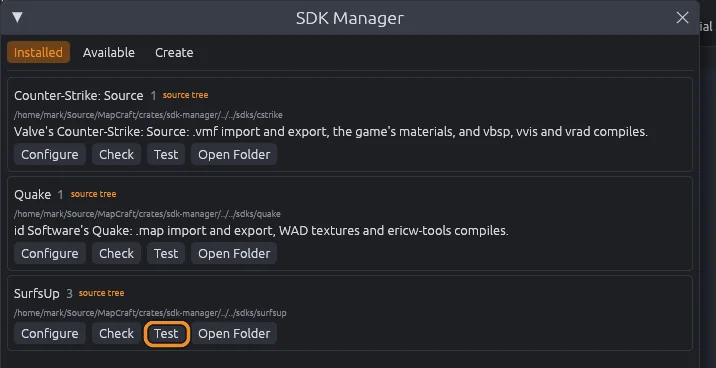
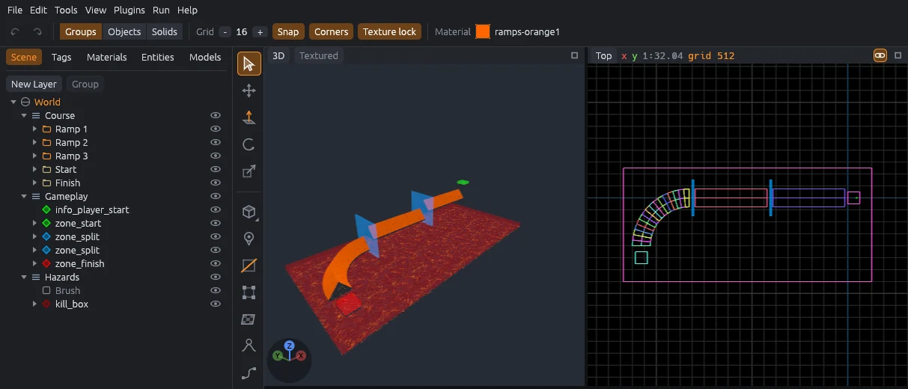

# Install MapCraft

This page gets MapCraft onto your computer, adds the SDK for your game, and checks that it runs.
MapCraft works on Linux, Windows and macOS, with any graphics driver that has Vulkan, DirectX 12, Metal or OpenGL.

## Linux

1. Download `MapCraft-x86_64.AppImage` from the [latest release](https://github.com/bearlikelion/MapCraft/releases/latest).
2. Make it executable: in your file manager's **Properties**, allow running it as a program, or run `chmod +x MapCraft-x86_64.AppImage`.
3. Double click it.

> [!TIP]
> If it does not start because your system lacks FUSE, run it with `--appimage-extract-and-run`.

## Windows

1. Download `MapCraft-windows-x86_64.zip` from the [latest release](https://github.com/bearlikelion/MapCraft/releases/latest).
2. Unzip it anywhere, for example into your Documents folder.
3. Double click `MapCraft.exe`.

If Windows warns that the app comes from an unknown publisher, choose **More info**, then **Run anyway**.

## macOS

1. Download `MapCraft-macos.zip` from the [latest release](https://github.com/bearlikelion/MapCraft/releases/latest).
2. Double click it to unzip it, and drag `MapCraft.app` into your Applications folder.
3. Double click `MapCraft.app`.

MapCraft needs macOS 11 or newer, on Apple Silicon or Intel.

> [!NOTE]
> MapCraft is not signed by Apple yet, so the first time you open it, macOS says it cannot check it for malicious software.
> Click **Done**, open **System Settings > Privacy & Security**, and click **Open Anyway** next to MapCraft.
> You only need to do this once.

## Add an SDK

MapCraft knows no game by itself: each game is an SDK, which you install once.
The first time MapCraft starts, the **Add an SDK** window lists the SDKs you can install, such as SurfsUp, Counter-Strike: Source and Quake.

1. Click **Install…** on the card of your game.
2. Check what it installs, and click **Install**.
3. When it is done, **SDK Settings** opens: point it at your game, as [the Tutorial](../tutorial/README.md#tell-it-where-your-game-is) shows for SurfsUp.

MapCraft needs the internet for this; if the list does not load, check your connection and click **Retry**.
**Not now** closes the window, and it opens again the next time MapCraft starts until an SDK is installed.
To add more SDKs later, open **File > SDK Manager** and its **Available** tab.

## Check that it works

Opening a sample map is a quick way to see that everything loaded.

1. Choose **File > SDK Manager**.
2. Click **Test** (with the play icon) next to the SDK you installed.

The SDK's sample map opens, or, for an SDK without one, its check runs.
The SurfsUp sample is a curved surf ramp with a start and a finish.
If **SDK Settings** opens too, MapCraft still needs a folder of your game; [the Tutorial](../tutorial/README.md#tell-it-where-your-game-is) shows how to set it for SurfsUp.

**Help > About MapCraft** shows the version you are running, the loaded plugins and the installed SDKs, which are worth including when you report a bug.

## Add the Godot addon

To play your maps in a Godot game such as SurfsUp, you also need the MapCraft addon in that game.
Download `MapCraft-godot-addon.zip` from the same release and unzip it into your Godot project's folder.
It works in Godot 4.4 and newer on Linux, Windows and macOS.
Then follow [Play it in Godot](godot.md).

## Other ways to get it

- To build MapCraft yourself, see [Building from source](../building.md).
- For more games, open **File > SDK Manager**, or add folders of SDKs in **Edit > Preferences**; see [SDKs and plugins](sdks-and-plugins.md#where-mapcraft-looks-for-sdks).
