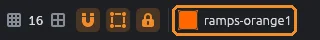
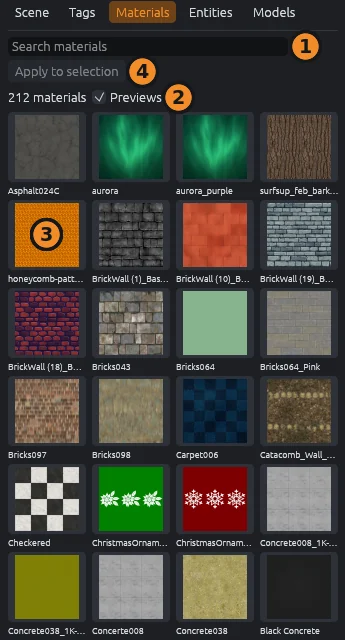
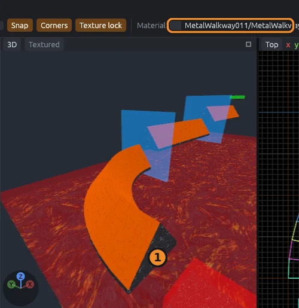
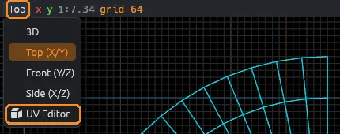
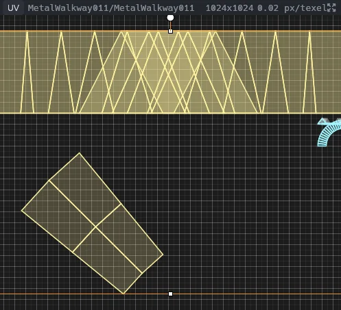
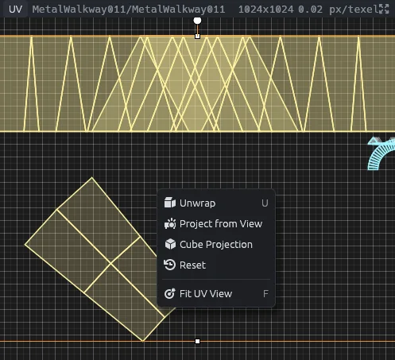
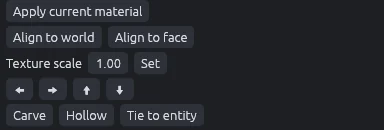
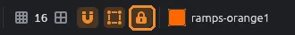
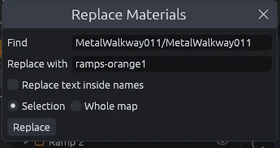

# Materials

Pick a material, put it on faces and align it.
Keys here are from the MapCraft preset; see [Keyboard shortcuts](shortcuts.md) for the Hammer and TrenchBroom presets.

## The current material

New brushes and the apply commands use the current material.
The **Material** chip on the top bar shows it; click the chip to open the Materials panel.

When the SDK names a default material and texture scale, they become current as the SDK loads.

## The Materials panel

Open the **Materials** tab on the left (`Ctrl+3`).
It lists every material of the map's SDK, including the [texture folders](sdks-and-plugins.md#texture-folders) you added in SDK Settings.

1. Type in **Search materials** to filter by name.
2. **Previews** switches between pictures and a plain list of names.
3. Click a material to make it current.
   With brushes selected or faces picked, the click also puts it on them, as in TrenchBroom.
4. **Apply to selection** gives the current material to the picked faces, or else to every face of the selected brushes.

Without an SDK the panel asks you to pick one with **File > New Map**.

> [!TIP]
> To make a click only set the current material, turn off **Clicking a material applies it to the selection** in **Edit > Preferences**.
> A double click then applies it.

## Applying a material

| Do this | Puts the current material on |
|---|---|
| `Shift+T` (**Tools > Apply Current Material**) | The picked faces, or else every face of the selected brushes |
| **Apply current material** in the inspector | The same |
| Click a material in the Materials panel | The same, unless you turned that off |
| Alt+right click a face in the 3D view | Only that face |

Alt+right click works in any tool, so you can paint faces without switching tools.

## Picking a material

Alt+click a face in the 3D view to make its material current.
The status bar shows **Picked** and the material's name.
MapCraft also remembers that face's alignment, for [wrapping](#wrapping-alignment).

## Copying and pasting faces

1. Press `Shift+F` for the Face tool and click the face that looks right.
2. Press `Ctrl+C` to copy it.
3. Pick the faces to change and press `Ctrl+V`.

A paste copies the material, the alignment and settings such as lightmap scale.
It turns the texture across shared edges, so it runs on around corners.
**Paste face** in the face panel does the same, and Alt+click also copies the face it picks.

## Wrapping alignment

Wrapping carries a texture around a corner without a seam.

1. Alt+click a face that already looks right.
2. Alt+Shift+right click the next face along.
3. Keep going, face after face.

Each face gets the material and alignment of the face you Alt+clicked, turned across the edge where they meet.
Until you have Alt+clicked a face, Alt+Shift+right click only applies the current material.

## The face panel

Press `Shift+F` for the Face tool and pick faces (see [Tools](tools.md#face)).
The inspector shows the face panel.
It shows the first picked face's values, and every change applies to all picked faces.

| Control | Does |
|---|---|
| **Apply current material** | Gives the picked faces the current material |
| **Paste face** | Gives them the material and alignment of the face you last copied (`Ctrl+C` or Alt+click), wrapped across shared edges |
| **Offset** U and V | Slides the texture, in texels |
| **Scale** U and V | Map units per texel; bigger stretches the texture (0 is ignored) |
| **Rotation** | Turns the texture by the amount you change it |
| **Justify Fit** | Stretches the texture so one copy covers the face |
| **Justify L, R, T, B** | Lines up the texture's left, right, top or bottom edge with the face's |
| **Justify C** | Centers the texture on the face |
| **Align to world** | Projects the texture straight from the nearest world axis and clears the rotation |
| **Align to face** | Lays the texture on the face with V pointing downhill; floors and ceilings get world alignment |
| **Lightmap scale** | Sets the face's lightmap scale; clear it to remove the setting |

The **Displacement** section below is covered in [Terrain](displacements.md).

## The UV editor

The UV editor lays the picked faces out flat over their texture, like Blender's UV Editor.

1. Pick faces with the Face tool.
2. Click a view's name in its header.
3. Choose **UV Editor**.
   Pick 3D, Top, Front or Side there to turn it back.

In the UV editor:

- The active face's texture repeats in every direction, with the first tile outlined in orange.
- Each picked face is drawn on it, filled with the color of its island (faces that share an edge and a material).
- The active face, the one you picked last, has a white outline.
- Picks are shared with the Face tool: pick here or in the 3D view, and both show it.

| Do this | To |
|---|---|
| Scroll | Zoom |
| Middle or right drag | Pan |
| Double click | Fit the picked faces in the view |
| Click a face | Pick only that face; Ctrl+click or Shift+click adds or removes it |
| Drag a box | Pick the faces whose middle is inside it; with Ctrl or Shift it adds them |
| Right click | Open the unwrap commands |

### Grab, rotate and scale

With the pointer over a UV editor, press `G` to grab, `R` to rotate or `S` to scale the picked faces' textures.
The textures follow the pointer, in the 3D view too, until you finish.

| Key | Does |
|---|---|
| `X` or `Y` | Locks a grab or scale to U or to V; press again to unlock |
| Hold `Ctrl` | Snaps a grab to whole texels, a rotation to 15 degrees and a scale to tenths |
| Click or `Enter` | Applies the change |
| `Escape` or right click | Puts everything back |

Every picked face moves by the same amount, so an island stays whole.
The whole change is one undo step.
These keys only work over a UV editor: `R` still picks the Rotate tool in the other views.

### Unwrapping

Right click in the UV editor, or open **Tools > UV**, for four commands on the picked faces:

| Command | Does |
|---|---|
| **Unwrap** (`U` over a UV editor) | Lays each island out so the texture runs on across its shared edges without a seam |
| **Project from View** | Projects one texture onto every picked face, the way the 3D view sees it |
| **Cube Projection** | Projects each face's texture from the nearest world axis, like **Align to world** |
| **Reset** | Gives each face the mapping a new face gets |

Unwrap does what [wrapping](#wrapping-alignment) does by hand, for every face of an island at once.
A closed shape such as a box still has one seam where the faces meet again.

> [!TIP]
> The right click menu in any view has a **UV** submenu that also works on selected brushes: right click a ramp and choose **UV > Unwrap**.

## Texturing whole brushes

With brushes selected in the Select tool, the inspector has:

- **Apply current material** for every face.
- **Align to world** and **Align to face** for every face.
- **Texture scale** with **Set**, which gives every face that scale.
- Four arrow buttons that slide every face's texture 16 texels.

## Texture lock

Texture lock is on by default.
Toggle it with `Shift+L`, the **Texture lock** button on the top bar, or **Tools > Texture Lock**.

- **On:** textures stick to brushes as you move, rotate, scale, flip, duplicate or paste them.
- **Off:** textures stay put in the world and the brushes slide under them.

Mirror groups have their own texture lock; see [Mirror groups](mirror-groups.md).

## Replace Materials

**Tools > Replace Materials** swaps one material for another on many faces at once.

1. **Find** starts as a material of the selected brushes; type another to change it.
2. **Replace with** starts as the current material.
3. Choose **Selection** or **Whole map**.
4. Click **Replace**.

Only faces whose whole material name matches **Find** change, ignoring case.
Tick **Replace text inside names** to swap a piece of text in every name instead (matching case), for example `dev/` with `concrete/` to move a set of materials to another folder.
The status bar says how many faces changed, and one `Ctrl+Z` undoes it all.
It has no key by default; bind one in **Edit > Preferences**.

