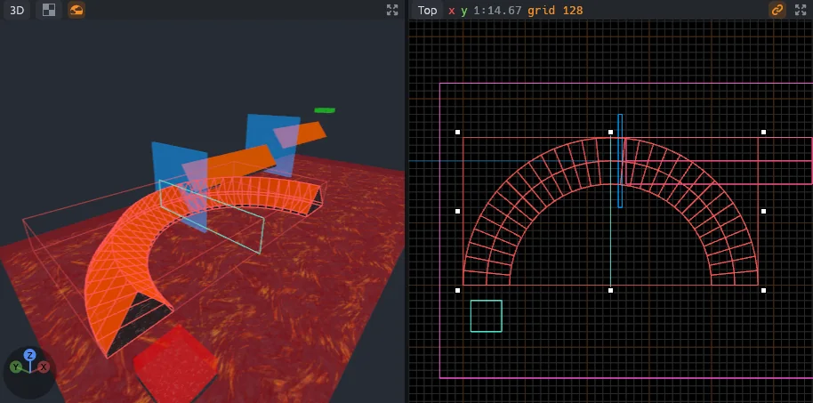
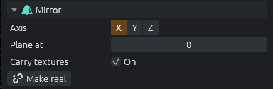

# Mirror groups

A mirror group draws the other half of a symmetric map from the half you build.

## Make a mirror group

1. Build one half of the map, up to the middle line.
2. Select it.
3. Press `Ctrl+Shift+M` (**Tools > Make Mirror Group**).

The other half appears, mirrored left and right across a plane at a fixed X.

- The selection goes into a new group named Mirror. If you selected one group, that group becomes the mirror group instead.
- The plane goes through the edge of your half nearest the map's origin, or through 0 when your half spans the origin.
- The group's **Carry textures** starts as the top bar's **Texture lock** setting.

> [!TIP]
> Mirrors can nest: build a quarter, mirror it, then select the mirror group, mirror it again and set the outer group's **Axis** to Y.

## How the mirror follows

- The mirrored half follows every edit to your half.
- Clicking the mirrored half selects the original it copies (or its group, depending on the selection mode).
- Moving the mirror group moves its plane with it.
- While the mirror group, or anything in it, is selected, the plane is outlined in the views.

## Mirror settings

Select the mirror group to change it in the inspector.

| Setting | Does |
|---|---|
| **Axis** | X mirrors left and right, Y front and back, Z up and down. Changing it moves the plane to that axis's default spot. |
| **Plane at** | Where the plane sits along the axis |
| **Carry textures** | On, copies carry their textures across the plane. Off, they keep the originals' texture alignment. |
| **Make real** | Turns the mirrored half into ordinary objects (below) |

### How the copy is made

- A brush touching the plane meets its copy with no gap.
- A brush crossing the plane adds only the part its reflection does not already fill, and a brush centered on the plane adds nothing.
- Point entities get the mirrored position and turn to face the way the reflection does. A point entity or prefab lying on the plane is not doubled.
- Prefabs are copied as prefabs, turned rather than flipped.

Check for Problems checks the mirrored half too, and reports its problems on the originals.

## Make Mirror Real

**Tools > Make Mirror Real**, or **Make real** in the inspector, turns the mirrored half into ordinary objects inside the group and stops mirroring.
It works when a mirror group is selected, changes nothing in the views, and is one undo step.

> [!WARNING]
> Ungrouping a mirror group drops the mirrored half.
> Make it real first if you want to keep it.

## In the game

The saved map holds both halves, so Godot and other importers get the whole symmetric map without knowing about mirrors.
MapCraft rebuilds the mirrored half from your half each time it opens the map.
A prefab whose file holds a mirror group comes in with that mirror made real.

For importer authors: [the .mcmap format](../mcmap-format.md#mirror-groups).
