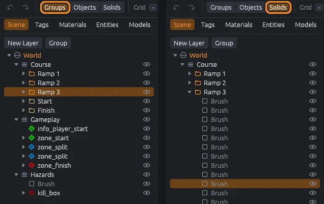
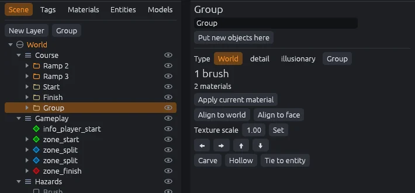
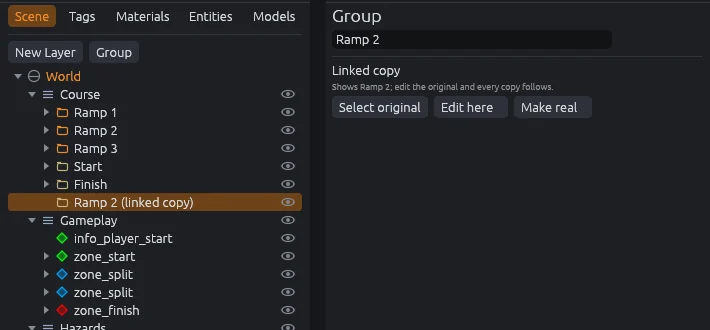
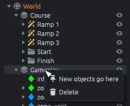
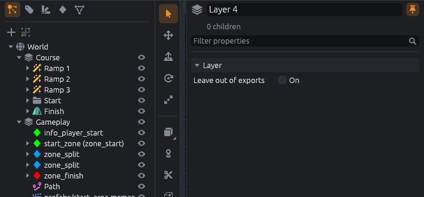
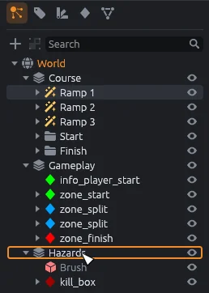
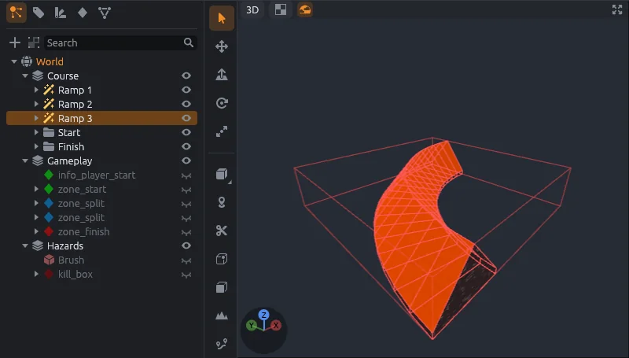
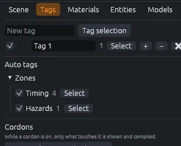
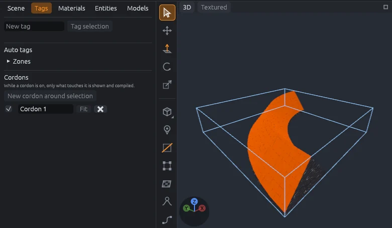

# Organizing

A map is a tree: the world at the top, then layers, groups, entities, brushes and prefabs.
This page shows how to select inside that tree and keep a big map tidy.

## Selection modes

The **Groups**, **Objects** and **Solids** buttons on the top bar decide what a click in a view selects.

| Mode | Key | A click selects |
|---|---|---|
| **Groups** | `Alt+1` | The outermost group around what you click, else its entity, else the brush |
| **Objects** | `Alt+2` | The entity or loose brush, ignoring groups |
| **Solids** | `Alt+3` | Just the one brush |

- `Ctrl+Click` or `Shift+Click` adds an object to the selection, or takes it out.
- `Ctrl+A` selects everything that is not hidden, and `Ctrl+Shift+A` selects nothing.
- The modes are also under **Edit > Selection Mode**.

## Drill select

Click the same spot again, in the same view, to select the object behind the one you have.
Keep clicking to cycle through everything under the pointer.

## Groups

1. Select some objects.
2. Press `Ctrl+G` (**Tools > Group**, or **Group** above the scene tree).

The new group is named Group, sits where the first selected object was, and ends up selected.
Rename it in the inspector.

`Ctrl+U` (**Tools > Ungroup**) breaks the selected groups apart; their contents stay selected.

> [!WARNING]
> Ungrouping a surf ramp or another generator keeps its brushes but loses its settings.
> Ungrouping a [mirror group](mirror-groups.md) loses its mirrored half.

## Linked copies

A linked copy shows another group's contents and follows every change to it, like Blender's linked duplicates.
Build a light fixture once, place copies all over the map, and change them all by changing one.

1. Select a group.
2. Press `Alt+D` (**Edit > Duplicate Linked**).

The copy lands one grid step away and is selected.
A selection that is not a single group is grouped first, and that group becomes the original.

- Move, turn, flip or scale each copy on its own; a flipped copy is a mirror image.
- Edit inside the original (switch to **Objects** or **Solids** to reach it) and every copy changes. Moving the original group itself moves only the original.
- **Edit here** (**Tools > Edit Linked Copy Here**) makes this copy the original, so you can edit through it.
- **Make real** (**Tools > Make Linked Copy Real**) turns a copy into an ordinary group that no longer follows.
- **Select original** on a copy, and **Select copies** on an original.
- Duplicating a copy with `Alt+D` or `Ctrl+D` adds another copy of the same original.

The scene tree marks copies **(linked copy)**.
If the original is deleted, its copies show nothing, and Check for Problems reports them.
The saved map holds each copy's contents too, so the game sees them without knowing about links.

## Where new objects go

New brushes, entities, zones, generators and prefabs go into one place: the world, a layer or a group.
Its name shows in orange in the scene tree.

- Right click a layer, group or the world in the scene tree and choose **New objects go here**.
- Or select a layer or group and click **Put new objects here** in the inspector.

## Layers

Layers sit right under the world and hold groups, entities, brushes and prefabs.
They cannot be nested.

- **New Layer** above the scene tree (`Ctrl+Shift+N`) adds a numbered layer and makes it where new objects go.
- Rename a layer in the inspector.
- Tick **Leave out of exports** to keep a layer out of Godot and the compiles, for reference pieces or work in progress.
- Each import lands in a layer of its own.

## The scene tree

The **Scene** tab (`Ctrl+1`) shows the whole map.
Each row has a fold arrow, an icon (entities in their class color), a name and an eye.
Entities with a `targetname` show as `name (class)`.

- Click a row to select it; `Ctrl+Click` adds it or takes it out.
- Double click a row to select it and focus the views on it.
- Right click a row for **New objects go here** and **Delete**.
- Click the eye to hide or show a node and everything in it.

Selecting something in a view unfolds the tree down to it and scrolls to it.

### Drag to reorder or reparent

Drag a row and drop it:

- on the middle of a row to move it inside that layer, group or brush entity;
- near the top or bottom edge of a row to put it before or after that row.

A line or outline shows where it will land.
Dragging a selected row moves the whole selection, and each move is one undo step.
A brush entity only takes brushes, layers stay under the world, and a generator group (such as a surf ramp) refuses drops because it rebuilds its own contents.

## Hide, isolate and show all

| Command | Key | Does |
|---|---|---|
| **View > Hide Selected** | `H` | Hides the selection |
| **View > Isolate Selected** | `I` | Hides every brush, entity and prefab outside the selection |
| **View > Show All** | `U` | Shows everything hidden with the eye, Hide or Isolate |

- Hidden objects cannot be clicked, and Select All skips them.
- Hiding can be undone and is saved with the map, but it only affects the editor: hidden objects still go to Godot.
- Show All leaves tags alone, since each tag has its own switch.

> [!TIP]
> To keep something out of Godot and the compiles, put it on a layer and tick **Leave out of exports**.

## Lock and unlock

| Command | Key | Does |
|---|---|---|
| **View > Lock Selected** | `Ctrl+Alt+K` | Locks the selection so it cannot be clicked, sculpted or carved |
| **View > Unlock All** | `Ctrl+Alt+Shift+K` | Unlocks everything |

Locking can be undone and is saved with the map.
Lock a reference layer, such as an imported map you are zoning, so clicks only reach what you are building.

## Tags

Tags are labels you stick on objects, like Hammer's visgroups.
An object can carry several.

1. Select the objects.
2. Open the **Tags** tab (`Ctrl+2`).
3. Type a name into **New tag** and click **Tag selection**. With no name you get Tag 1, Tag 2 and so on.

Each tag's row has:

- a checkbox that shows or hides everything with the tag;
- its name, which you can edit;
- how many objects carry it;
- **Select**, which selects them;
- **+** and **−**, which add the selection to the tag or take it out;
- a button that deletes the tag (the objects stay).

### Auto tags

When the SDK's entity definitions (its FGD) list `@AutoVisGroup` sets, they show under **Auto tags**, grouped under their parent name, like Hammer's auto visgroups.
The SurfsUp SDK has **Zones** with **Timing** and **Hazards**.
Each set gathers the entities of the classes it lists; hover its name to see them.

- The checkbox shows or hides every entity in the set.
- **Select** selects them.

Auto tags are not saved in the map: membership follows the entity classes.
Sets with no entities in the map are left out.

## Cordons

A cordon is a box that hides everything outside it, so you can work on one part of a big map.
Cordons sit below the tags in the **Tags** tab.

1. Select the part you want to work on.
2. Click **New cordon around selection**.

The cordon turns on and shows as a blue box; only what touches it stays visible.

- The checkbox turns a cordon on or off.
- **Fit** fits a cordon to the current selection.
- Cordons can be renamed and deleted, and every change can be undone.

> [!WARNING]
> Cordons are saved with the map, and the Godot addon leaves out everything outside an active cordon.
> Turn cordons off before you build the map for the game.
