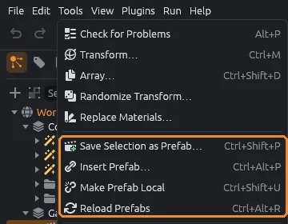
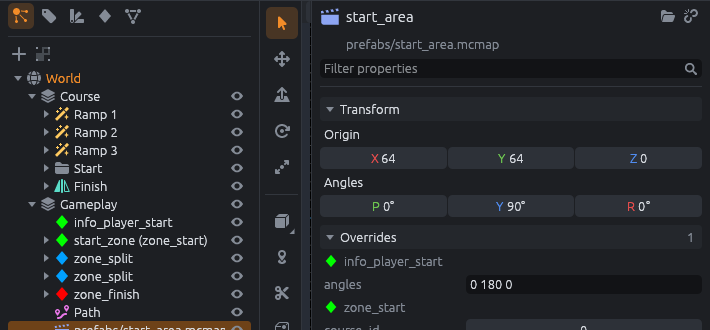
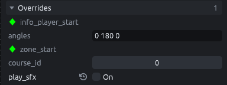
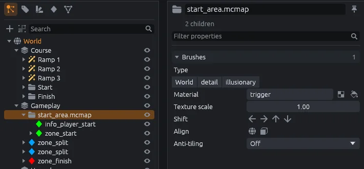

# Prefabs

A prefab is a piece of a map kept in its own `.mcmap` file and placed as instances, like a Godot scene or a Hammer instance.
Change the prefab file and every instance changes with it.

## Save the selection as a prefab

1. Save your map first, so the prefab's path is stored relative to the map's folder.
2. Select what the prefab should hold.
3. Press `Ctrl+Shift+P` (**Tools > Save Selection as Prefab**) and pick a file name; the dialog starts in the map's folder.

The selection is written to that file, centered on the grid point nearest its middle.
In your map it is replaced by an instance of the file at that point.

## Insert a prefab

Press `Ctrl+Alt+P` (**Tools > Insert Prefab**) and pick a `.mcmap` file.
The instance lands on the grid point nearest where the pointer last was, goes where new objects go, and is selected.

Any `.mcmap` file can be a prefab.

## Work with an instance

An instance draws its contents, and clicking any of them selects the instance.
Move, turn, duplicate and delete it like any other object.

Select an instance to see in the inspector:

- the prefab's path;
- **Origin** and **Pitch Yaw Roll**, which place it;
- **Open prefab**, which opens the prefab's own file for editing (asking to save your map first);
- **Make local**, described below.

If the prefab file cannot be loaded, the inspector says so in red.

## Overrides

The inspector's **Overrides** section lists each entity in the prefab with its keys, except `origin`.
Change a value there to change it for this instance only.

- Overridden keys show in bold.
- The ↺ button next to an overridden key puts back the prefab's value.

## Make Prefab Local

`Ctrl+Shift+U` (**Tools > Make Prefab Local**, or **Make local** in the inspector) turns the selected instances into ordinary objects.

- Each instance becomes a group named after the prefab's path, holding a copy of its contents in place.
- Overrides are applied to the copies.
- Instances nested inside it are made local too.
- Layers in the prefab become groups, and mirror groups come in with their mirrored half made real.

## Reload Prefabs

MapCraft reads each prefab file once.
After you change a prefab file, press `Ctrl+Alt+R` (**Tools > Reload Prefabs**) to read them all again.

## Nesting and cycles

A prefab can hold instances of other prefabs, up to 16 levels deep.

A prefab that contains itself, directly or through other prefabs, is refused.
The status bar says `<path> contains itself`, the instance is not drawn, and Make Prefab Local fails with the same message.
Nesting deeper than 16 levels is refused the same way.

## Prefabs in Godot

- The Godot addon loads each instance's prefab `.mcmap` as a scene instance, looking for it relative to the map, so the prefab files must be in the Godot project too.
- It does not apply overrides yet.
- The SurfsUp SDK's Run profiles copy only the map file into the game.

> [!IMPORTANT]
> For a SurfsUp map, use **Make Prefab Local** before you play it from the Run menu.
