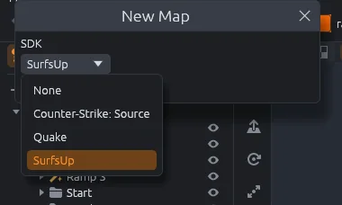
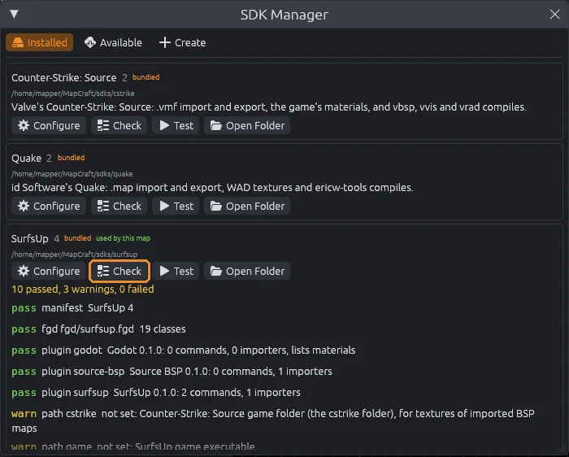
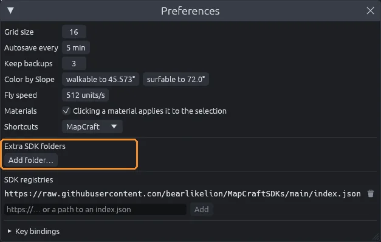
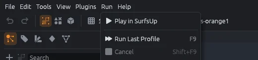
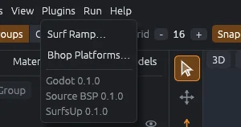
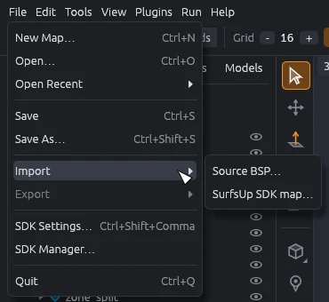

# SDKs and plugins

MapCraft knows no game by itself.
An **SDK** teaches it one game, and **plugins** add the code that game needs, such as surf ramp generators and map importers.

## What an SDK is

An SDK is a folder that tells MapCraft about one game:

- which entities exist, such as spawns, triggers and lights;
- where the game's materials are, and which one new brushes get;
- how far a map may reach, for games with a limit (Quake's is -4096 to 4096 on every axis, Source's -16384 to 16384);
- which plugins to load;
- which folders and programs on your computer it needs;
- how to compile and play a map, listed in the **Run** menu.

Your game's files stay where they are; the SDK only points at them.
MapCraft ships with SDKs for SurfsUp, Counter-Strike: Source and Quake.
To write your own, see [SDK manifests](../sdk-format.md).

## Each map remembers its SDK

You pick the SDK when you make a map with **File > New Map**.
The map remembers it, and opening the map loads that SDK again.
If the SDK is not installed, the status bar says so, and entities and materials are unavailable.

### Switch a map's SDK

1. Click the SDK name in the status bar at the bottom of the window, or choose **File > Switch SDK**.
2. Pick another SDK, or **None**.

MapCraft reloads materials, entities, plugins and settings for the new SDK, and the map keeps all its brushes and entities.
If the new SDK needs folders you have not set yet, **SDK Settings** opens by itself.
When the map uses entities the new SDK does not define, the status bar names them and **Check for Problems** (`Alt+P`) lists each one.
The SDK is saved with the map, so the map becomes unsaved.
Switching is not an undo step: to go back, switch to the old SDK again.

## The SDK Manager

**File > SDK Manager** lists every SDK MapCraft found.

- **Configure** opens the SDK's settings.
- **Check** tests the SDK and lists what passed, what needs a look, and what failed.
- **Test** opens the SDK's sample map.
- **Open Folder** shows the SDK's folder.

The **Available** tab installs more SDKs from SDK registries, and **Create** starts a new SDK from a template or [imports a TrenchBroom game made with func_godot](trenchbroom.md).
Hosting your own registry is covered in [SDK registries](../sdk-registry.md).

## Where MapCraft looks for SDKs

- MapCraft finds the SDKs it ships with by itself.
- SDKs you install or create in the SDK Manager go into the `sdks` folder of MapCraft's data folder: `~/.local/share/mapcraft/sdks` on Linux, `%LOCALAPPDATA%\mapcraft\sdks` on Windows, `~/Library/Application Support/mapcraft/sdks` on macOS.
- To use SDKs kept somewhere else, add the folder that holds them under **Extra SDK folders** in **Edit > Preferences** (`Ctrl+Comma`).
  **Add folder** and **Remove** rescan right away.

When two folders hold an SDK with the same id, the one found first wins.
With a map that has no SDK, **File > SDK Settings** lists every folder searched.
The full search order, including the `MAPCRAFT_SDK_PATH` variable, is in [SDK manifests](../sdk-format.md#where-sdks-are-found).

## SDK Settings

**File > SDK Settings** (`Ctrl+Shift+Comma`) tells the current SDK where things are on your computer.

- Type a path, or click **Browse** to pick the file or folder.
- A path that does not exist turns red.
- Settings that materials or entities need come first; hover a name to see why.
- While one of those is empty, the window opens by itself when the SDK loads.
- Click **Apply**, or just close the window, to reload the SDK with the new paths.

Paths are saved per SDK, so every map made with that SDK shares them.

### The SurfsUp settings

| Setting | Used for |
|---|---|
| SurfsUp Godot project folder | Materials (from `Assets/Textures`), and **Play in SurfsUp project** |
| Godot editor executable | Running the project for **Play in SurfsUp project** |
| SurfsUp game executable | **Play in SurfsUp** |
| Folder SurfsUp loads maps from | Where **Play in SurfsUp** copies the map |
| Counter-Strike: Source game folder | Stock textures of [imported BSP maps](importing-bsp.md) |

## Compile profiles

The **Run** menu, and the **Run** button at the top right, list the SDK's compile profiles.
A profile builds or plays your map: it copies files and starts programs, one step after another.

- Running a profile saves the map first, asking for a file name if it has none.
- The Output panel opens and shows each step, then `== finished ==` or `== failed: ... ==`.
- A profile stops at the first step that fails, and a path left empty in SDK Settings stops it with an error.
- `F9` (**Run Last Profile**) runs the last profile again, or the first one if none has run yet.
- `Shift+F9` (**Run > Cancel**) stops a running profile.

### The trust prompt

Profiles run programs the SDK names, so the first time you run one from an SDK, MapCraft asks **Run this SDK's programs?**
**Allow** runs it and remembers your answer for that SDK; **Cancel** runs nothing.

> [!WARNING]
> Only allow SDKs you trust.

## Plugins

Plugins add the code a game needs.
They can be written in Rust, C, C++, C#, Go, Python, JavaScript or Zig, and they run in a sandbox:

- no network, no other programs and no environment variables;
- they can only read the SDK's material folders and the game folders it lists;
- a plugin that runs too long or uses too much memory is stopped with an error instead of freezing the editor;
- a plugin that crashes is turned off until the SDK loads again.

An SDK loads the plugins it lists from its own `plugins` folder.
Every `.wasm` file in the `plugins` folder of MapCraft's data folder (`~/.local/share/mapcraft/plugins` on Linux) loads too, for every map, even one with no SDK.
If two plugins share an id, the SDK's wins.
Problems loading a plugin show in the Output panel (`Ctrl+5`).

To write your own, see the [Plugin API](../plugin-api.md); `plugins/stairs-py` is a small generator written in Python.

### Commands

Plugin commands live in the **Plugins** menu.
Each opens a window with its settings; **Create** puts the result at the center of the selection, or where the pointer last was, snapped to the grid.
The bottom of the menu lists the loaded plugins and their versions.

### Generators

Generators are commands whose result stays editable.
They also appear as shapes of the Block tool, with a ghost to place them by clicking.

- The result is a group that remembers its settings: select it and change any of them in the inspector to rebuild it, in one undo step.
- Moving or turning the group moves the generator too.
- The scene tree does not let you drag other objects into the group.
- When the plugin is not loaded, the inspector names the plugin that made the group, and you can still edit its brushes by hand.

### Importers and material lists

Importers appear under **File > Import**, and what they bring in goes into a new layer named after the file.
Dropping a file on the MapCraft window runs the importer that reads its extension too.
Material lists replace the plain list of images from the SDK's material folders, as the Godot plugin does with a project's `.tres` materials.

### The plugins MapCraft ships with

| Plugin | Adds |
|---|---|
| `godot` | Lists a Godot project's `.tres` materials, previewed by their texture or color, plus images no material uses |
| `surfsup` | The Surf Ramp and Bhop Platforms generators (see [Surf ramps and bhop](surf.md)), and **File > Import > SurfsUp SDK map** for maps made with the SurfsUp SDK in Godot (see [Import a SurfsUp SDK map](importing-sdk.md)) |
| `source-bsp` | **File > Import > Source BSP**; see [Import a BSP map](importing-bsp.md) |
| `source` | A Source game's materials, and **File > Import** and **File > Export** of Hammer `.vmf` files; see [Counter-Strike: Source](cstrike.md) |
