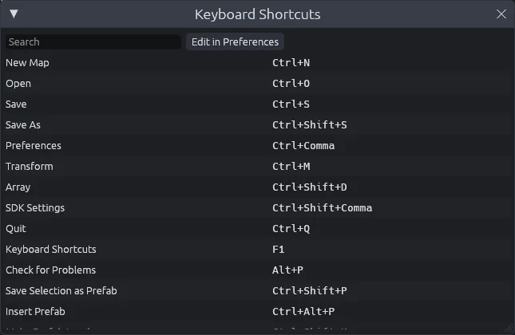
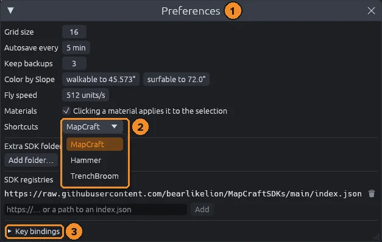

# Keyboard shortcuts

Menu items, panels, tools and switches can all have shortcuts, and you can change any of them.
The Hammer and TrenchBroom presets use those editors' keys, so you can keep the keys you already know.
[Hotkeys](hotkeys.md) covers the keys you use most, and its [cheat sheet](hotkeys.md#every-key-on-one-page) prints every key on one page.

## See every shortcut

Press `F1` for the list of every shortcut, with a search box.
**Edit in Preferences** opens Preferences so you can change them.

Menus and tooltips also show the current key, so you can pick them up as you go.

## Search commands

When you know what you want but not where it lives, press `F3` (**Edit > Search Commands**) and type part of a command's name, such as `drop` or `hollow`.

- The list shows each match with its icon and key; hover one to see its menu.
- `Up` and `Down` move through the list, `Enter` or a click runs the command, and `Escape` closes it.
- Commands that cannot run right now are grayed out, and the ones you ran last come first.
- Typing the first letters of each word also finds a command, such as `dtf` for Drop to Floor.

## Change a shortcut

1. Open **Edit > Preferences** (`Ctrl+Comma`).
2. Pick a preset under **Shortcuts**: MapCraft, Hammer or TrenchBroom.
3. Open **Key bindings** and type a chord such as `Ctrl+Shift+K` next to an action, or clear it to unbind the action.

To go back to the preset's key, click the circular arrow after the action's key (**Back to the preset's chord**).

- Keys you type win over the preset, so they survive a preset switch.
- A chord MapCraft cannot read turns red.
- No two actions share a key in any preset.

> [!NOTE]
> Some keys only work in one place, where they win over the same key elsewhere:
> - the UV editor's keys work with the pointer over a UV editor;
> - the Vertex tool's keys (select modes, Merge, Bevel and Delete) work in the Vertex tool;
> - Remove Last Clip Point (`Delete`) works in the Clip tool.

## Show pressed keys

For screen recordings and tutorials, MapCraft can show each shortcut you press over the views.
Pick a corner under **Show pressed keys** in **Edit > Preferences** (`Ctrl+Comma`): Top Left, Top Right, Bottom Left or Bottom Right.
It is off to start with.

- Each press shows its keys as the menus write them, such as `Ctrl+Shift+D`, and the command it ran.
- The last four presses stack up, the newest nearest the corner, and each fades out after a second and a half.
- Pressing the same shortcut again counts it, such as `x3`, instead of adding another line.
- Keys typed into text fields, such as the inspector or a search box, are not shown.

## All shortcuts

These are the MapCraft preset's keys.
The tables are generated from the editor's code, so they match the version this site was built from.

<!-- shortcuts:start -->

### File

| Action | Shortcut |
|---|---|
| New Map | `Ctrl+N` |
| Open | `Ctrl+O` |
| Save | `Ctrl+S` |
| Save As | `Ctrl+Shift+S` |
| Revert | *none* |
| Import glTF | *none* |
| Export glTF | *none* |
| Reload Assets | `F5` |
| SDK Settings | `Ctrl+Shift+Comma` |
| Switch SDK | *none* |
| SDK Manager | *none* |
| Quit | `Ctrl+Q` |

### Edit

| Action | Shortcut |
|---|---|
| Search Commands | `F3` |
| Preferences | `Ctrl+Comma` |
| Undo | `Ctrl+Z` |
| Redo | `Ctrl+Shift+Z` |
| Delete | `Delete` |
| Duplicate | `Ctrl+D` |
| Duplicate Linked | `Alt+D` |
| Select All | `Ctrl+A` |
| Select None | `Ctrl+Shift+A` |
| Select Faces by Material | *none* |
| Select Brushes by Material | *none* |
| Select Groups | `Alt+1` |
| Select Objects | `Alt+2` |
| Select Solids | `Alt+3` |

### Tools

| Action | Shortcut |
|---|---|
| Select Tool | `Q` |
| Move Tool | `W` |
| Extrude Tool | `E` |
| Rotate Tool | `R` |
| Scale Tool | `T` |
| Block Tool | `B` |
| Entity Tool | `N` |
| Clip Tool | `C` |
| Vertex Tool | `V` |
| Face Tool | `Shift+F` |
| Sculpt Tool | `D` |
| Path Tool | `P` |

### Tool options

| Action | Shortcut |
|---|---|
| Smart Edit | `Ctrl+Alt+E` |
| Next Block Shape | `Alt+B` |
| Next Clip Side | `Ctrl+Enter` |
| Remove Last Clip Point | `Delete` |

### Brushes and organizing

| Action | Shortcut |
|---|---|
| Transform | `Ctrl+M` |
| Array | `Ctrl+Shift+D` |
| Randomize Transform | *none* |
| Replace Materials | *none* |
| Roll 90° Clockwise | *none* |
| Roll 90° Counter-Clockwise | *none* |
| Pitch 90° Clockwise | *none* |
| Pitch 90° Counter-Clockwise | *none* |
| Yaw 90° Clockwise | *none* |
| Yaw 90° Counter-Clockwise | *none* |
| Check for Problems | `Alt+P` |
| New Layer | `Ctrl+Shift+N` |
| Edit Linked Copy Here | *none* |
| Make Linked Copy Real | *none* |
| Carve | `Ctrl+Shift+C` |
| Subtract | `Ctrl+Shift+B` |
| Add | `Ctrl+Alt+B` |
| Release from Boolean | *none* |
| Apply Boolean | *none* |
| Hollow | `Ctrl+H` |
| Zone from Selection | *none* |
| Snap Selection to Grid | `Ctrl+B` |
| Group | `Ctrl+G` |
| Ungroup | `Ctrl+U` |
| Make Mirror Group | `Ctrl+Shift+M` |
| Make Mirror Real | *none* |
| Sweep Along Path | `Ctrl+Alt+S` |
| Spin | `Ctrl+Alt+N` |
| Array Along Path | `Ctrl+Alt+D` |
| Make Curve Real | *none* |
| Tie to Entity | `Ctrl+T` |
| Drop to Floor | `End` |
| Move to World | `Ctrl+Shift+W` |
| Center Origins | *none* |
| Rotate 90° Clockwise | `Ctrl+R` |
| Rotate 90° Counter-Clockwise | `Ctrl+Shift+R` |
| Flip X | `Ctrl+L` |
| Flip Y | `Ctrl+I` |
| Flip Z | `Ctrl+Alt+L` |
| Merge Brushes | `Ctrl+J` |
| Apply Current Material | `Shift+T` |
| Clear Material | *none* |
| Texture Lock | `Shift+L` |

### Prefabs

| Action | Shortcut |
|---|---|
| Save Selection as Prefab | `Ctrl+Shift+P` |
| Insert Prefab | `Ctrl+Alt+P` |
| Make Prefab Local | `Ctrl+Shift+U` |
| Reload Prefabs | `Ctrl+Alt+R` |

### View

| Action | Shortcut |
|---|---|
| Maximize View | `Space` |
| Link 2D Zoom | `Shift+Z` |
| Next Render Mode | `Z` |
| Textured | `Ctrl+Alt+1` |
| Flat Shaded | `Ctrl+Alt+2` |
| Wireframe | `Ctrl+Alt+3` |
| Lit | `Ctrl+Alt+4` |
| Show Sky | *none* |
| Color Brushes by Object | `Ctrl+Alt+C` |
| Color by Slope | `Ctrl+Alt+5` |
| Frame All | `Home` |
| Go to Origin | `Shift+Home` |
| One View Layout | `Shift+Space` |
| Focus Selection | `F` |
| Find Entities | `Ctrl+F` |
| Snap to Grid | `Shift+W` |
| Snap to Corners | `Shift+Q` |
| Lock Selected | `Ctrl+Alt+K` |
| Unlock All | `Ctrl+Alt+Shift+K` |
| Hide Selected | `H` |
| Isolate Selected | `I` |
| Show All | `U` |
| Smaller Grid | `[` |
| Larger Grid | `]` |

### Panels

| Action | Shortcut |
|---|---|
| Scene Panel | `Ctrl+1` |
| Search Scene | `Ctrl+Shift+F` |
| Tags Panel | `Ctrl+2` |
| Materials Panel | `Ctrl+3` |
| Entities Panel | `Ctrl+4` |
| Models Panel | `Ctrl+6` |
| Output Panel | `Ctrl+5` |

### Run

| Action | Shortcut |
|---|---|
| Run Last Profile | `F9` |
| Cancel Run | `Shift+F9` |
| Load Leak Trail | *none* |
| Unload Leak Trail | *none* |
| Next Leak Point | `Period` |
| Previous Leak Point | `Comma` |

### Help

| Action | Shortcut |
|---|---|
| Keyboard Shortcuts | `F1` |
| About MapCraft | *none* |

### UV editor

| Action | Shortcut |
|---|---|
| UV Grab | `G` |
| UV Rotate | `R` |
| UV Scale | `S` |
| Fit UV View | `F` |
| Unwrap | `U` |
| Project from View | *none* |
| Cube Projection | *none* |
| Reset UVs | *none* |

### Vertex tool

| Action | Shortcut |
|---|---|
| Vertex Select Mode | `1` |
| Edge Select Mode | `2` |
| Face Select Mode | `3` |
| Merge Vertices | `M` |
| Bevel Edges | `Ctrl+B` |
| Delete Vertices or Dissolve Faces | `Delete` |
| Set Origin to Selected Corners | *none* |

### Other

| Action | Shortcut |
|---|---|
| Sculpt: Raise | `1` |
| Sculpt: Lower | `2` |
| Sculpt: Smooth | `3` |
| Sculpt: Flatten | `4` |
| Sculpt: Noise | `5` |
| Sculpt: Paint | `6` |
| Sculpt: Blur | `7` |
| Blend Current Material | *none* |
| Remove Blend Material | *none* |
| Fill Blend | *none* |
| Invert Blend | *none* |
| Clear Blend | *none* |

### Mouse and fixed keys

These cannot be rebound.

| Action | Keys |
|---|---|
| Copy, or copy the active face in the Face tool | `Ctrl+C` |
| Cut | `Ctrl+X` |
| Paste, or paste a face on the picked faces in the Face tool | `Ctrl+V` |
| Cancel the current drag or tool step, leave the tool, then deselect | `Escape` |
| Apply the clip | `Enter` |
| Extrude a face | `Shift+Drag` |
| Slide a face, keeping its shape | `Alt+Shift+Drag` |
| Extrude into a new brush | `Ctrl+Shift+Drag` |
| Stamp a copy along a face | `Ctrl+Alt+Shift+Drag` |
| Pick a face's material, unless a face is picked in the Face tool | `Alt+Click` |
| Transfer the active face's material and alignment as it is, in the Face tool | `Alt+Click, Alt+Drag, Alt+Double-click` |
| Transfer the active face's material and alignment wrapped around corners, in the Face tool | `Alt+Shift+Click, Alt+Shift+Drag, Alt+Shift+Double-click` |
| Transfer only the active face's material, in the Face tool | `Ctrl+Alt+Click, Ctrl+Alt+Drag, Ctrl+Alt+Double-click` |
| Apply or wrap the picked material | `Alt+Right Click, Alt+Shift+Right Click` |
| Fly the 3D camera | `Right Drag + WASD` |
| Change the fly speed | `Right Drag + Scroll` |
| Lock a UV grab or scale to U or V | `X, Y` |
| Snap a UV grab, rotate or scale | `Ctrl` |
| Apply a UV grab, rotate or scale | `Click, Enter` |
| Cancel a UV grab, rotate or scale | `Escape, Right Click` |
| Move the picked faces' UVs | `Drag a picked face in a UV editor` |
| Scale UVs; Shift keeps a corner's aspect | `Drag a square handle in a UV editor` |
| Rotate UVs | `Drag the round handle in a UV editor` |
| Change a bevel's segments while sizing it | `Scroll` |
| Apply a bevel being sized | `Click, Enter` |
| Cancel a bevel being sized | `Escape, Right Click` |
| Move a 3D vertex handle or block height up and down | `Shift+Drag, Alt+Drag` |
| Move the selection up and down in the 3D view | `Alt+Drag` |
| Add a third clip point that tilts the cut | `Click in another view` |
| Clip along a face | `Double-click the face in the 3D view` |
| Move a clip point | `Drag the point` |
| Move a brush entity's origin | `Drag its handle in a 2D view` |
| Nudge the selection one grid step, or the picked handles in the Vertex tool | `Arrow keys` |
| Nudge the selection one unit | `Shift+Arrow keys` |
| Nudge a copy of the selection, leaving the original | `Ctrl+Arrow keys` |
| Move a copy of the selection, leaving the original | `Ctrl+Drag` |
| Pick a face from the Select or Move tool | `Shift+Click in the 3D view` |
| Orbit the 3D camera around the point under the pointer | `Alt+Right Drag` |

### Hammer and TrenchBroom presets

These actions change when you pick a preset; everything else keeps the keys above.

| Action | Hammer | TrenchBroom |
|---|---|---|
| Select Tool | `Shift+S` | `Q` |
| Block Tool | `Shift+B` | `B` |
| Entity Tool | `Shift+E` | *none* |
| Clip Tool | `Shift+X` | `C` |
| Vertex Tool | `Shift+V` | `V` |
| Face Tool | `Shift+A` | `Shift+F` |
| Carve | `Ctrl+Shift+C` | `Ctrl+K` |
| Hollow | `Ctrl+H` | `Ctrl+Shift+K` |
| Ungroup | `Ctrl+U` | `Ctrl+Shift+G` |
| Flip Y | `Ctrl+I` | *none* |
| Tie to Entity | `Ctrl+T` | *none* |
| Isolate Selected | `I` | `Ctrl+I` |
| Hide Selected | `H` | `Ctrl+Alt+I` |
| Show All | `U` | `Ctrl+Shift+I` |
| Smaller Grid | `[` | `Minus` |
| Larger Grid | `]` | `Plus` |
| Roll 90° Clockwise | *none* | `Alt+Up` |
| Roll 90° Counter-Clockwise | *none* | `Alt+Down` |
| Pitch 90° Clockwise | *none* | `Alt+PageUp` |
| Pitch 90° Counter-Clockwise | *none* | `Alt+PageDown` |
| Yaw 90° Clockwise | *none* | `Alt+Left` |
| Yaw 90° Counter-Clockwise | *none* | `Alt+Right` |

<!-- shortcuts:end -->
