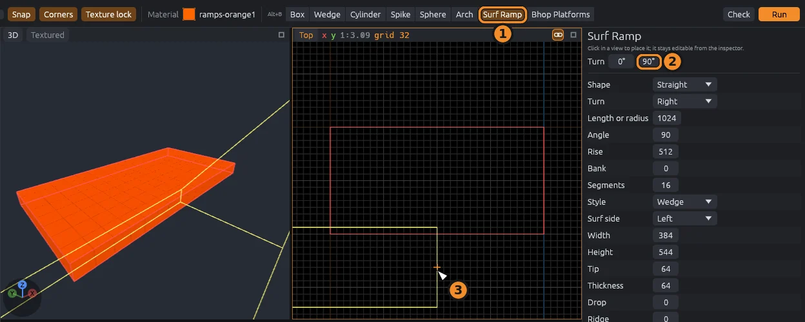
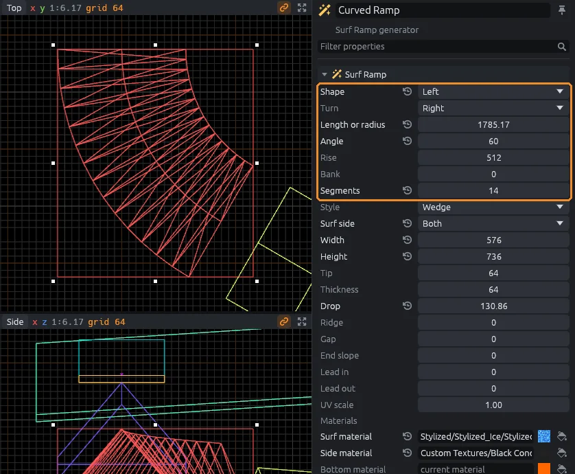
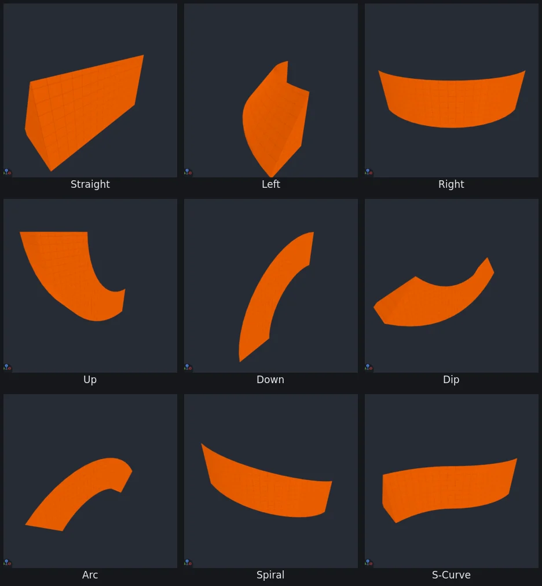
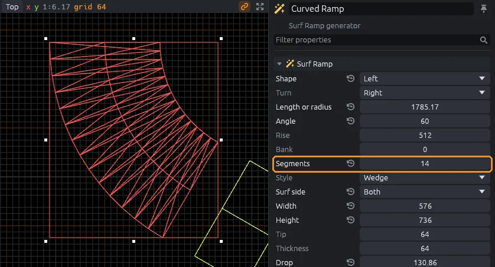
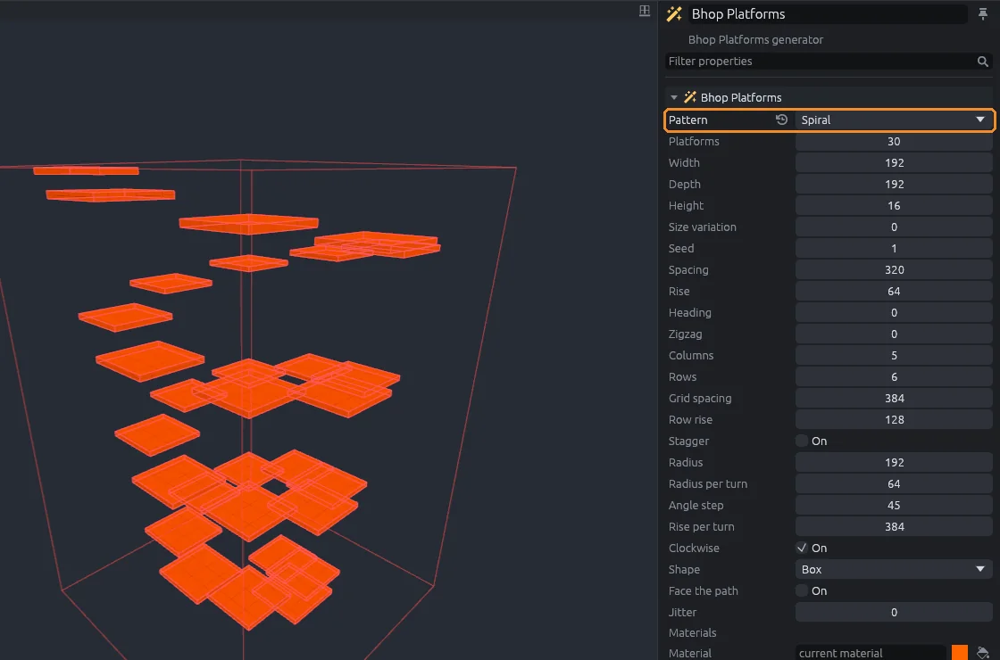
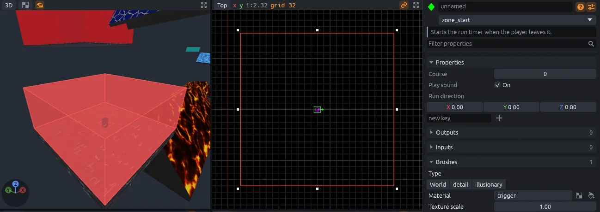
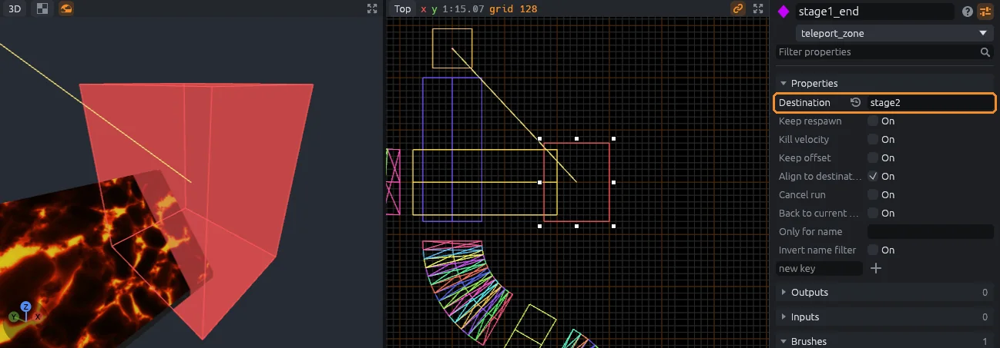

# Surf ramps and bhop

The SurfsUp SDK adds two shapes to the Block tool: **Surf Ramp** and **Bhop Platforms**.
Both stay editable after you place them.

## Place a ramp

1. Press `B` for the Block tool, then click **Surf Ramp** in the top bar.
2. Set **Turn**, or click **90°** to add a quarter turn.
3. Click in a view to place it: on the ground or a face in the 3D view, or at the last block's depth in a 2D view.

A yellow ghost shows where it will land, and stays where the pointer left it while you change settings.
`Alt+B` switches back to the plain shapes.
The **Plugins** menu makes the same ramps from a window instead.

## Edit a placed ramp

A placed ramp is a group that remembers its settings.
Select it with the Select tool (`Q`) and change its settings in the inspector: the ramp rebuilds as you type, as one undo step.
Each shape also remembers the settings you last used, until you quit.

## Pick a shape

**Shape** sets the path the ramp follows.

| Shape | Follows |
|---|---|
| Straight | A straight line |
| Left, Right | A flat curve turning left or right |
| Up, Down | A curve that bends upward or downward along its length |
| Dip | A valley: down, then back up |
| Arc | A hump: up, then back down |
| Spiral | A curve that keeps turning and climbs by **Rise** |
| S-Curve | A turn one way, then the other |

**Length or radius** is the length of a straight ramp, or the radius of a curve.
**Angle** is how far a curve turns, in degrees.

## Shape the cross-section

| Setting | Does |
|---|---|
| **Style** | **Wedge** is a solid ramp; **Thin** is a slab under the surf face |
| **Surf side** | The side players surf: Left, Right, Both, or Inside for a trough of two ramps facing each other |
| **Width**, **Height** | The size of the cross-section |
| **Tip** | A base under a wedge's low edge, so the face never thins to a knife edge players can slip through |
| **Thickness** | How thick a thin ramp's slab is |
| **Ridge** | A flat top on the peak, or the floor of an Inside trough |
| **Bank** | Leans a curve into its turn |
| **Drop** | Height the ramp loses along its length; on a straight ramp it makes a slide |
| **Gap** | Breaks the ramp into pieces this far apart |
| **End slope** | Straight only: the base reaches past the top at each end; negative undercuts, and length 0 makes a pyramid |
| **Lead in**, **Lead out** | Straight runs before and after a curve |
| **Surf**, **Side** and **Bottom material** | Empty uses the current material; **Use current** fills one in |

## Keep it surfable

A face is surfable when it is steeper than 45.573 degrees; anything flatter is floor players can walk on.
The default ramp is 544 tall and 384 wide with a 64 tip, about 51 degrees.

If a ramp comes out too flat, the Output panel (`Ctrl+5`) says so.
Make it taller or narrower to steepen it.

> [!NOTE]
> The angle is `atan((height - tip) / width)`. [Surf mapping](../surf-mapping.md) has the geometry behind it.

## Smooth curves

Curves are built from straight pieces, and a seam between pieces can stop a player dead.
Keep each piece to 5 degrees of turn or less: **Segments** should be at least the **Angle** divided by 5.
A 90 degree turn needs 18 segments or more.
The Output panel warns when a curve has too few.

> [!TIP]
> In Godot, the SurfsUp entity map turns on trimesh collision, so the seams between pieces cannot catch players. See [Play it in Godot](godot.md#import-options).

## Bhop platforms

1. Click **Bhop Platforms** in the Block tool's top bar.
2. Pick a **Pattern**: **Linear**, **Grid** or **Spiral**.
3. Click in a view to place them.

**Platforms** sets how many.
Each pattern has its own settings, named after it in the inspector, such as **Spacing** and **Rise** for Linear or **Radius** and **Rise per turn** for Spiral.
**Shape** makes them boxes, triangles or cylinders, **Size variation** and **Jitter** make them uneven, and **Face the path** turns each one toward the next.

## Zones

Zones are see-through boxes that the game watches: start and finish timers, checkpoints, teleports and kill boxes.
[Your first map](first-map.md#6-add-start-and-finish-zones) shows how to make one, and [Entities and zones](entities.md) lists every zone class.

- Make zones at least 256 units tall, so players cannot jump over them.
- Make them at least 64 units thick, so fast players cannot skip through them between ticks.
- Make start zones big enough to strafe in before leaving.
- Space checkpoints so each stage takes about ten seconds or more.
- Put a kill zone under every stage.

**Check** (`Alt+P`) warns about zones that are too short or too thin, and about a player start outside the start zone.

## Teleports between stages

1. Put a `teleport_destination` where the next stage starts, and give it a name.
2. Make a `teleport_zone` where the stage ends.
3. Set the zone's **Destination** to that name.

A yellow line joins the selected zone to its destination.
Point each destination the way the stage continues, so players arrive facing forward.

## Symmetric maps and terrain

- Build one half of a map and mirror it: [Mirror groups](mirror-groups.md).
- Sculpt rocky ground around the course: [Terrain](displacements.md).
