# Tools

Every tool lives in the column left of the views.
Click one or press its key; keys here are the MapCraft preset's (see [Keyboard shortcuts](shortcuts.md)).

## The tool column

1. **Select** `Q`
2. **Move** `W`
3. **Extrude** `E`
4. **Rotate** `R`
5. **Scale** `T`
6. **Block** `B`
7. **Entity** `N`
8. **Clip** `C`
9. **Vertex** `V`
10. **Face** `Shift+F`
11. **Sculpt** `D`
12. **Path** `P`

Hover a tool to see its key, and read the status bar for a hint on using it.
`Escape` goes back to Select from any other tool.
A whole drag is one undo step, so `Ctrl+Z` takes all of it back.

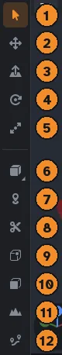

## The right click menu

Right click in any view, without dragging, for the tools that fit what is selected, as in Blender.

- **Objects selected:** Duplicate, Duplicate Linked, Delete, Hollow, Carve, Merge and Clip, then the **Brush Type**, **Transform**, **UV**, **Organize** and **Curves** submenus, then Focus, Hide, Isolate and Lock. A linked copy adds its linked copy commands.
- **Faces picked in the Face tool:** Apply Current Material, Copy Face, Paste Face, the **UV** submenu, Sweep Along Path and Spin.
- **In the Vertex tool:** the select modes, Merge at Center and Bevel Edges come first.
- **Nothing selected:** **Add** (every Block shape and generator, Entity and Path), Select All, Show All, Unlock All, Frame All and Go to Origin.

Each entry shows its shortcut, and entries that cannot run are grayed out.

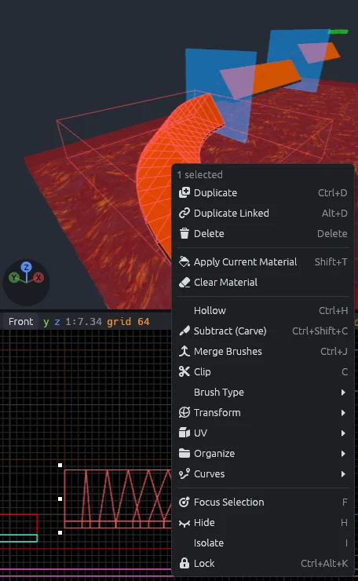

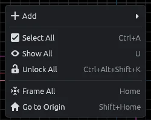

> [!TIP]
> The **UV** submenu works straight from selected brushes: right click a ramp and choose **UV > Unwrap**.
> **Edit UVs in This View** turns the view you clicked into the [UV editor](materials.md#the-uv-editor).

Right dragging still flies the 3D camera and pans a 2D view.
Alt+right click still applies the current material to a face, and a right click still cancels a bevel being sized.

## Select

Press `Q`.

- Click an object to select it.
- Click the same spot again to select the object behind it.
- Ctrl+click or Shift+click adds an object, or takes it out.
- Click empty space to select nothing.

What a click selects follows the selection mode on the top bar: **Groups** (`Alt+1`), **Objects** (`Alt+2`) or **Solids** (`Alt+3`).
See [Organizing](organizing.md#selection-modes).

### Select in a 2D view

- Drag an object to move the selection.
- Drag from empty space to draw a box; it selects everything fully inside.
- Drag a white handle to resize the selection. The opposite side stays put, the moving sides turn red, and labels show the size.
- The arrow keys nudge the selection one grid step.

A selection cannot shrink below one grid step.

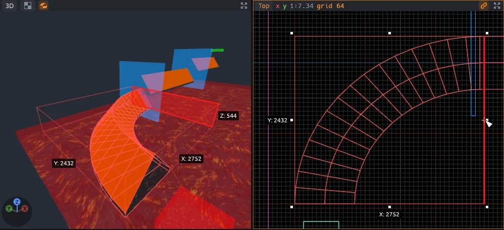

Shift+drag a face of a selected brush to extrude it, as the [Extrude](#extrude) tool does.
Ctrl+Shift+drag splits off a new brush, and Ctrl+Alt+Shift+drag stamps one.
In the 3D view, use Move to drag things.

## Move

Press `W`.

Move works like Select and adds three arrows at the selection's center in the 3D view.
Drag the red, green or blue arrow to move along X, Y or Z.
With **Snap** on, the selection's low side along that axis lands on the grid.

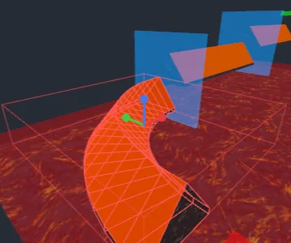

## Extrude

Press `E`.

1. Select the brushes to work on.
2. Hover a face: it turns red with a yellow outline. In a 2D view, it is the face seen edge on nearest the pointer.
3. Drag to push or pull the face; the brush grows or shrinks with it.

Faces of other selected brushes that lie in the same plane move along.

Pick how the face moves on the top bar:

- **Along normal**: the face moves straight out and keeps its shape, and new sides stand square to it, as in TrenchBroom.
- **Stretch**: the face's plane slides, and the faces around it stretch to meet it.

On a box both do the same; they differ on slanted faces, such as the slope of a ramp.

| Mouse | Does |
|---|---|
| Drag | Moves the face, resizing its brush |
| Ctrl+drag | Adds a new brush in the dragged volume instead; dragged inward, it splits the brush in two |
| Ctrl+Alt+drag | Stamps a new brush between the face and a moved copy of it |

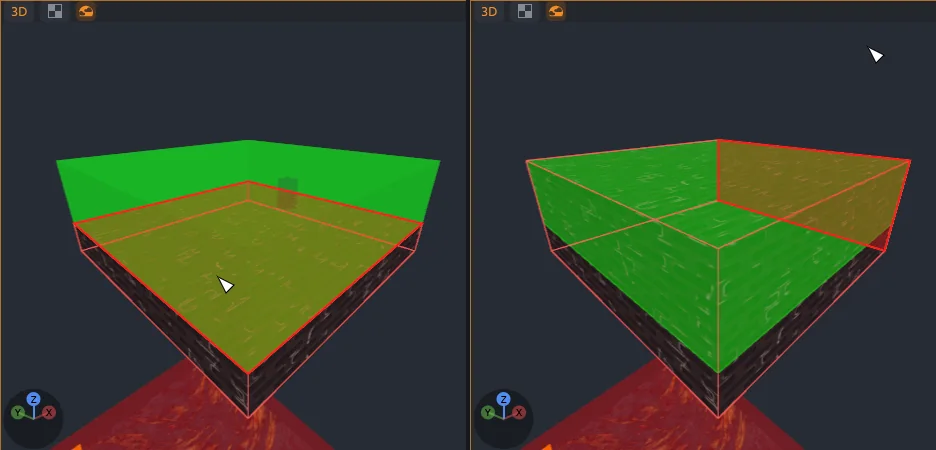

- The status bar shows how far you have dragged.
- With **Snap** on, straight faces land on the grid and slanted faces move in whole grid steps.
- A drag that would remove one of the brush's faces is refused.
- After a split or stamp, the new brushes are selected, ready for the next drag.

## Rotate

Press `R`.

- In a 2D view, drag around the selection's center (the orange circle and cross) to turn it.
- In the 3D view, drag a ring: red turns about X, green about Y, blue about Z.

With **Snap** on, rotation goes in 15 degree steps, and the status bar shows the angle.
For exact quarter turns about Z, use **Tools > Rotate 90° Clockwise** (`Ctrl+R`) or **Tools > Rotate 90° Counter-Clockwise** (`Ctrl+Shift+R`).

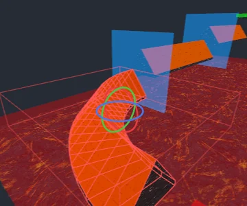

## Scale

Press `T`.

- In a 2D view, drag the white handles, as with Select.
- In the 3D view, drag a square handle at the end of the red, green or blue line.

Each axis has a bright handle on its positive side and a dim one on its negative side.
The side you drag moves and the opposite side stays put.
The moving side turns red and labels show the size.
A selection cannot shrink below one grid step, and with **Snap** on its edge lands on the grid.

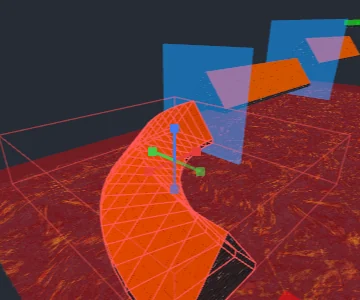

## Block

Press `B`.

1. Pick the Block tool.
2. Pick a shape on the top bar. You can also right click the Block icon, or press `Alt+B` to step through the shapes.
3. Drag a rectangle in a 2D view.

Labels show the block's size in every view while you draw.
New brushes get the current [material](materials.md), go [where new objects go](organizing.md#where-new-objects-go) and end up selected.

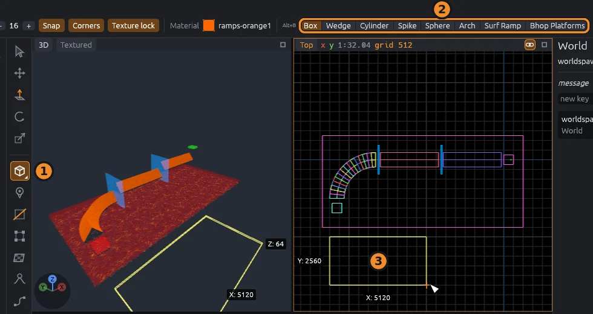

| Shape | Makes | Options |
|---|---|---|
| Box | A box | |
| Wedge | A ramp, full height at its low X side and sloping down to its high X side | |
| Cylinder | An upright prism inside the box you draw | sides, 3 to 64 |
| Spike | A pyramid or cone with its tip at the top | sides, 3 to 64 |
| Sphere | A sphere, or an egg shape when the box is uneven | sides, 4 to 32 |
| Arch | Blocks in a curve around Z, running **arc** degrees counter-clockwise from **start** degrees off +X, each **wall** units thick | sides 1 to 64, arc, start, wall |

### Drawing in a 2D view

Drag a rectangle.
Its depth matches the last block you drew; the first block is 64 units deep.

### Drawing in the 3D view

1. Press on a face to start on that face, or on empty ground to start at height 0.
2. Drag to size the base; the block rises as far as the last block you drew.
3. Hold `Shift` while dragging to set the height instead; let go of `Shift` to size the base again.
4. Release the mouse button to make the block.

### Generator shapes

Plugins add shapes to the bar, such as **Surf Ramp** and **Bhop Platforms** in the SurfsUp SDK.

1. Click the shape. Its settings show in the inspector, with **Turn** to rotate it (the **90°** button adds a quarter turn).
2. A yellow ghost follows the pointer: on the face or ground under it in the 3D view, or at the last block's depth in a 2D view.
3. Click to place it.

The ghost stays where the pointer left it, so you can watch it change as you edit its settings.

- A placed generator is a group that stays editable: select it, change any setting in the inspector, and it rebuilds.
- Each shape remembers the settings you last used until you quit.
- `Alt+B` switches back to the built-in shapes.
- The **Plugins** menu runs the same generators from a dialog.

See [Surf ramps and bhop](surf.md), or the [Plugin API](../plugin-api.md) to write your own.

## Entity

Press `N`.

1. Click a point entity class in the **Entities** tab (`Ctrl+4`); that also picks this tool.
2. Click in a view to place one.

- In the 3D view it lands on the surface under the pointer, snapped to the grid; clicking empty space places nothing.
- In a 2D view it lands under the pointer at the depth of the last block you drew (in the Top view, at that block's bottom).

The new entity gets its class's default values and is selected.
The tool starts out placing `info_player_start`.
See [Entities and zones](entities.md).

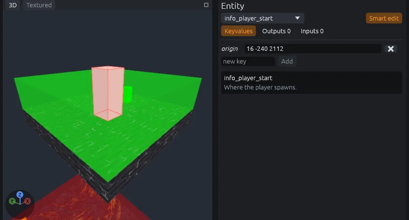

## Clip

Press `C`.

1. Select the brushes to cut.
2. Click two points, or press and drag a line, in any view. In a 2D view the cut runs straight back through the view; in the 3D view, start on a face and the cut runs straight into it.
3. The points show as yellow squares, with their coordinates in the 2D views. Drag a point to move it.
4. Check the preview: yellow parts stay, red parts go. The bigger part stays at first; press `Alt+C`, or click **Both**, **Front** or **Back** on the top bar, to change what stays.
5. Press `Enter` to cut. `Escape` clears the points; press it again to leave the tool.

After the cut, the pieces that stay are selected, and the Clip tool stays on for the next cut.

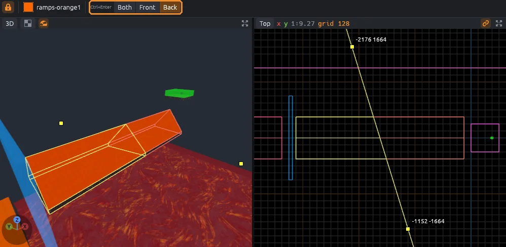

> [!TIP]
> To cut at any angle, place two points, then click a third point on a face in the 3D view: the cut tilts to run through all three.
> Clicking again after that, or after two points in a 2D view, starts a new line.

## Vertex

Press `V`.

Select brushes, then pick what to work on, as in Blender's edit mode:

| Mode | Key | Handles |
|---|---|---|
| Vertex | `1` | Yellow squares on the corners |
| Edge | `2` | Light blue squares on the edge middles |
| Face | `3` | Green dots on the face centers |

The mode buttons are on the top bar too, with **Merge** and **Bevel**.
These keys only work in the Vertex tool, where they win over the same keys elsewhere.
Switching mode keeps what the selected corners still fully cover, so two selected corners become their edge.

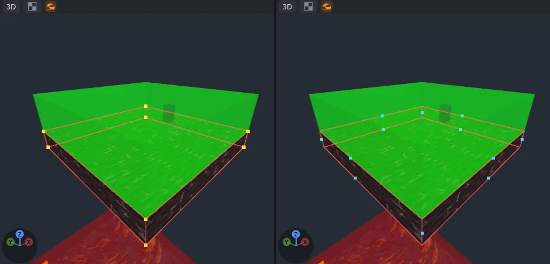

### Selecting

- Click a handle to select it; it turns orange.
- Shift+click or Ctrl+click adds a handle, or takes it out.
- Drag a box from empty space to select every handle inside; hold `Shift` to add or `Ctrl` to take away.
- Click away from the handles to select brushes as usual.

In a 2D view, a click takes everything stacked under the pointer, such as a corner and the corners hidden behind it.
In the 3D view it takes the nearest handle, plus the same corner of other selected brushes.
Each brush keeps its own selection, which follows the brush through edits.

### Moving

Drag any selected handle to move the whole selection.
In the 3D view the handles slide across the level plane; hold `Shift` to move them up and down.
For exact moves, hover a 2D view and press the arrow keys: the selected handles move one grid step at a time.

- The brush always stays a solid convex shape around its corners.
- A move that would break the brush is refused with "Cannot move there" in the status bar.
- Handles snap to the grid and to other corners, as **Snap** and **Corners** say.

### Merge

`M` collapses the selected corners of each brush to their center, as Blender's Merge at Center does.
In edge and face mode, it merges the corners of the selected edges or faces.
The merged corner stays selected, and each merge is one undo step.
A merge that would leave a flat or empty brush is refused.

### Bevel

`Ctrl+B` rounds off the selected edges with new faces, the way Blender's bevel does.
In vertex and face mode it bevels the edges between the selected corners.

1. Move the pointer away from the edges to set the width; it snaps to the grid while **Snap** is on.
2. Scroll to add or remove segments; one segment is a plain chamfer.
3. Click or press `Enter` to apply. `Esc` or a right click cancels.

The width and segments show next to the edges and in the status bar.
Afterwards, the **Adjust Last Bevel** window changes the width, segments and profile as one undo step, until you edit the brush again.
A profile of 0.5 is round, 0.25 or less is a flat chamfer, and values toward 1 make a boxier edge.

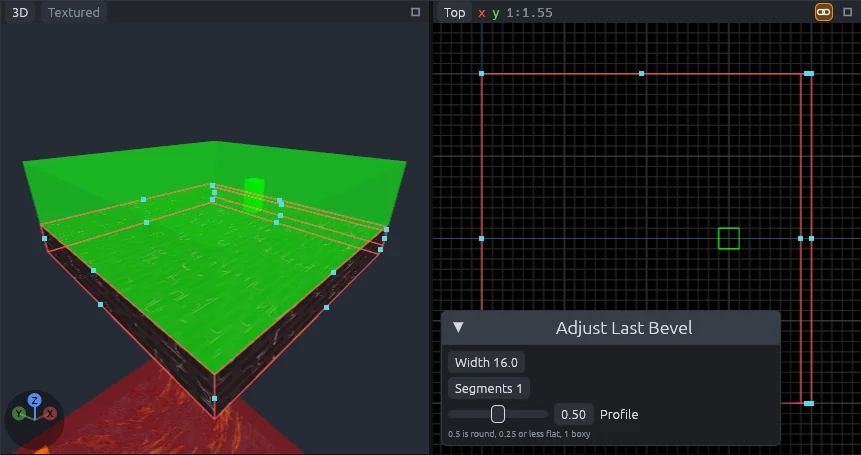

New faces take the material of the face beside them, with the texture turned to run on around the rounded edge.

Some bevels are refused, with the reason in the status bar:

- an edge that is not between two faces of the brush;
- a width larger than a face beside the edge;
- two edges whose bevels would run into each other, such as edges that share a corner.

Edges on opposite sides of a face can bevel together, and meet in the middle when the width is half the face.

## Face

Press `Shift+F`.

Switching to Face picks every face of the selected brushes, so you can texture them all at once.
Faces hidden between touching brushes, such as the joins between ramp pieces, are left out, and the status bar says how many.

- Click a face in the 3D view to pick just that face.
- Ctrl+click or Shift+click adds a face, or takes it out.
- Click empty space to pick nothing.

Picked faces keep their real color, outlined, so you can judge their materials.
The inspector shows the face panel: see [Materials](materials.md#the-face-panel) for texturing and [Terrain](displacements.md) for displacements.

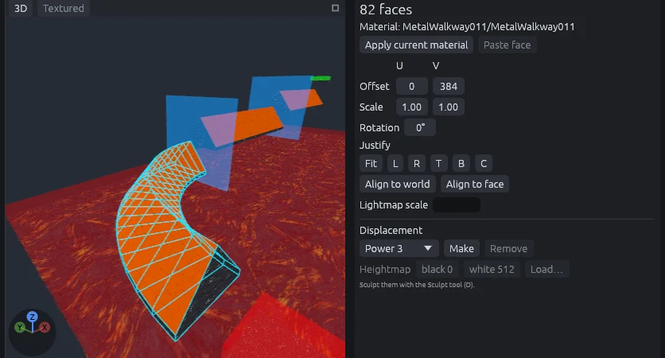

- `Ctrl+C` copies the active face's material and alignment, and `Ctrl+V` pastes them on the picked faces (see [Copying and pasting faces](materials.md#copying-and-pasting-faces)).
- A view turned into the [UV editor](materials.md#the-uv-editor) shares the picks.
- Leaving the Face tool drops the picks, except for the Sculpt tool, which keeps them to limit its strokes.

## Sculpt

Press `D`.

Drag on a displacement in the 3D view to raise, lower, smooth, flatten or roughen it.
The mode, radius and strength are on the top bar, and `Ctrl` swaps raise and lower.
See [Terrain](displacements.md#the-sculpt-tool).

## Path

Press `P`.

Click in a view to add the points of a curved path, and drag to pull out their handles.
Sweeps, spins and copies along a path live under **Tools > Curves**.
See [Paths, sweeps and spins](curves.md).

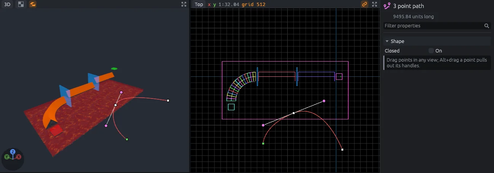

## Brush operations

These work on the selection and live in the **Tools** menu.

| Command | Key | Does |
|---|---|---|
| **Carve** | `Ctrl+Shift+C` | Cuts the selected brushes out of every other brush they touch; hidden, tagged off, locked and out of cordon brushes are left alone, and the selected brushes stay |
| **Hollow** | `Ctrl+H` | Turns each selected brush into walls one grid step thick around an empty inside, and selects the walls |
| **Merge Brushes** | `Ctrl+J` | Joins two or more selected brushes into one when together they make one convex shape; anything else, such as a curve, is refused |
| **Flip X**, **Flip Y**, **Flip Z** | `Ctrl+L`, `Ctrl+I`, `Ctrl+Alt+L` | Mirrors the selection through its center |
| **Rotate 90° Clockwise** | `Ctrl+R` | Turns the selection a quarter turn about Z through its center |
| **Rotate 90° Counter-Clockwise** | `Ctrl+Shift+R` | The same, the other way |
| **Snap Selection to Grid** | `Ctrl+B` | Moves each selected object, without reshaping it, so its lowest corner (or an entity's or prefab's origin) sits on the nearest grid point |
| **Transform** | `Ctrl+M` | Opens the Transform dialog |
| **Array** | `Ctrl+Shift+D` | Opens the Array dialog |

The brush inspector has **Carve** and **Hollow** buttons too.
While texture lock is on, moves, turns, flips and scales keep textures stuck to the brushes (see [Texture lock](materials.md#texture-lock)).

### The Transform dialog

Pick **Move**, **Rotate** or **Scale**, type X, Y and Z, and click **Apply**.

- **Move**: units along each axis.
- **Rotate**: degrees about each axis through the selection's center, applied X, then Y, then Z.
- **Scale**: factors along each axis from the selection's center.

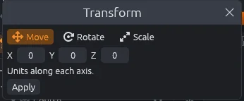

### The Array dialog

The Array dialog makes copies of the selection in one undo step, like Hammer's Paste Special.

- **Copies**: how many, up to 256.
- **Offset**: how far each copy moves from the one before it.
- **Turn**: degrees each copy turns from the one before it, about X, then Y, then Z, through the **Pivot**.
- **Pivot at selection** and **Pivot at origin** fill in the pivot.

A row of pillars is an offset with no turn.
A ring of them is a turn about Z with the pivot at the ring's center.
A spiral stair is both.
The copies end up selected.

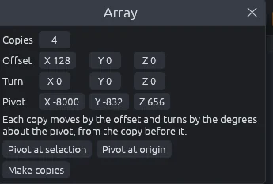
