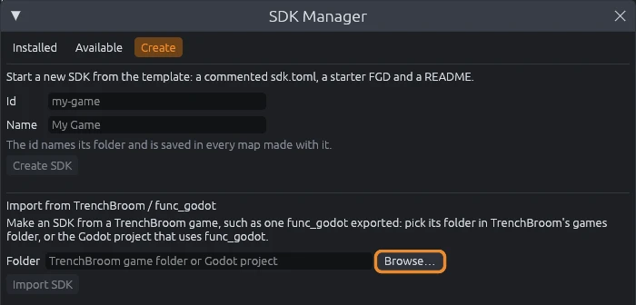

# TrenchBroom and func_godot

Make Godot maps with TrenchBroom and the func_godot addon?
Point MapCraft at your game and it builds an SDK with your entities, textures and scale, so you can keep making the same maps here and build them with func_godot as before.

## Before you start

In Godot, select your `TrenchBroomGameConfig` resource and click **Export GameConfig** in the inspector, as you do for TrenchBroom.
That writes `GameConfig.cfg` and your `.fgd` into TrenchBroom's games folder, where MapCraft reads them.

## Import your game

1. Choose **File > SDK Manager**, then the **Create** tab.
2. Under **Import from TrenchBroom / func_godot**, click **Browse…** and pick your Godot project folder, or your game's folder in TrenchBroom's games folder (`~/.TrenchBroom/games/<game>` on Linux, `%APPDATA%\TrenchBroom\games\<game>` on Windows).
3. Click **Import SDK**.

- The new SDK opens in the **Installed** tab and is checked right away.
- The message at the top lists anything MapCraft had to guess, such as a Godot project it could not find.
- Make a map with **File > New Map** and pick the new SDK.
- **File > SDK Settings** holds your Godot project folder; it is filled in when MapCraft found the project.

## What comes over

- **Entities:** every point and brush entity in your exported FGD, with their display models.
- **Materials:** the textures and `.tres` materials in func_godot's base texture folder, named as func_godot names them, so a face textured `walls/brick` builds with `walls/brick` in Godot.
- **Scale:** func_godot's inverse scale factor, so 32 map units are one Godot meter unless you changed it.
- **Default material:** the texture your maps use most.
- **Texture scale:** TrenchBroom's default texture scale for new faces.

## Send a map to Godot

1. Choose **Run > Export .map to Godot project**.
   MapCraft writes the map as a Valve `.map` into the folder your project keeps its maps in, named after your map.
2. In Godot, point your FuncGodotMap node at that file and click **Build**, as you do for maps made in TrenchBroom.

- Layers and groups are written as TrenchBroom writes them, so func_godot's groups hierarchy setting works, and layers left out of exports are dropped.
- When the folder already holds a different `.map` with that name, MapCraft keeps it as `<name>.map.bak`.
- To keep working on a map you made in TrenchBroom, open it with **File > Import > Quake map**.

> [!NOTE]
> The Output panel may say long texture names do not fit Quake's WADs and BSPs.
> That only matters for Quake; func_godot reads them fine.

## After you change your entities

Export the game config again in Godot, remove the SDK in the SDK Manager, and import it again.
The SDK keeps its id, which comes from your game's name, so your maps still find it.

## Limits

- MapCraft reads the FGD func_godot exported, not your FuncGodotFGDFile resources, so export the game config first.
- A Godot project leads to TrenchBroom's folder through the TrenchBroom game config folder you set in func_godot's local config; when that is not found, pick the TrenchBroom folder instead.
- TrenchBroom's folder leads to the project through the game path set in TrenchBroom's preferences.
- `.def` and `.ent` entity files, `.wal` textures, texture WADs listed in your map settings, and NetRadiant Custom gamepacks are not read.
- Clip, skip and origin textures are plain materials in MapCraft; func_godot still treats them as tool textures when it builds the map.

How each setting maps onto the SDK is in [TrenchBroom and func_godot import](../trenchbroom-import.md).
