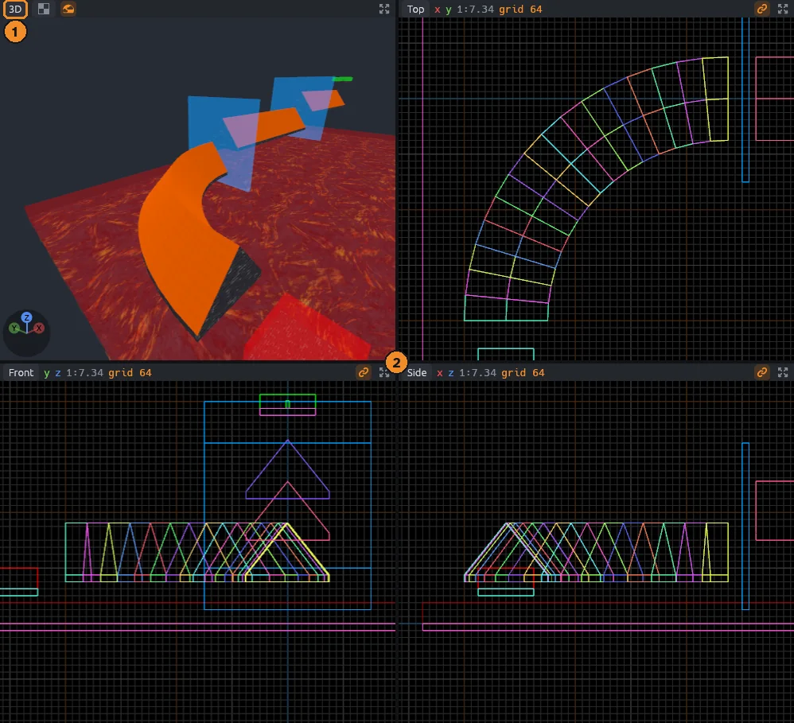
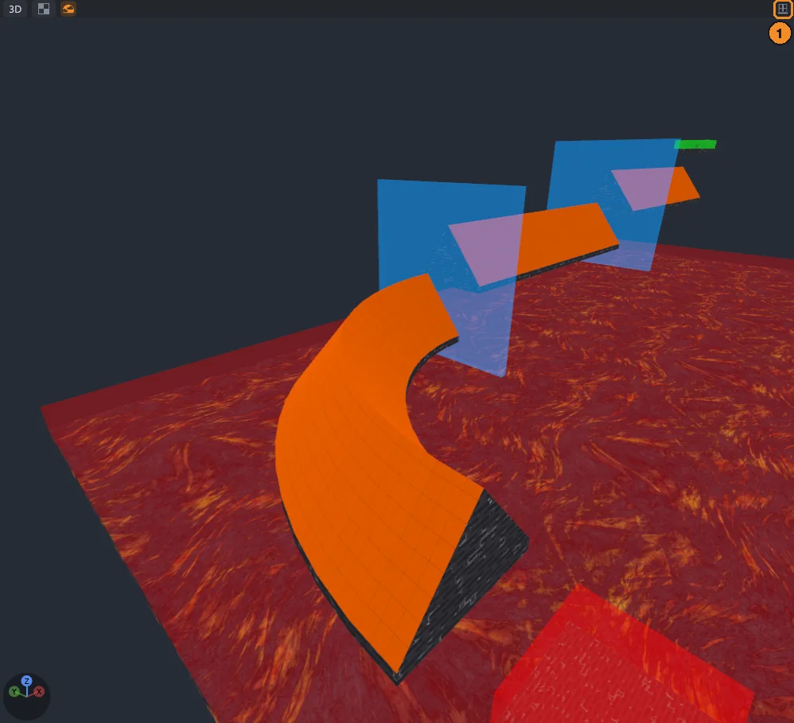
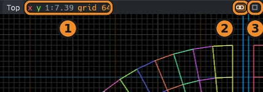
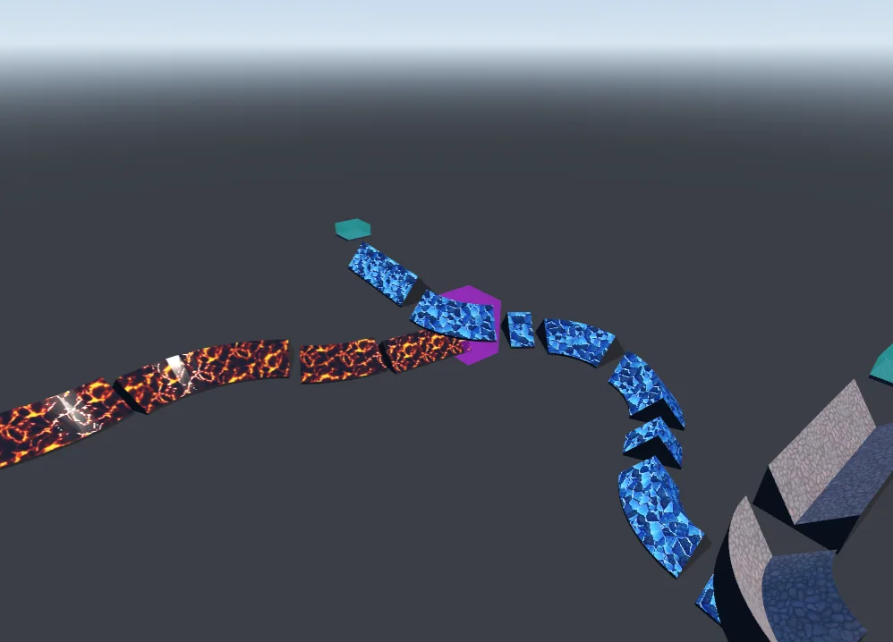
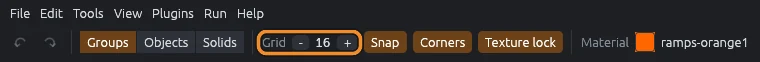
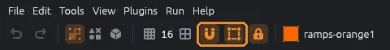
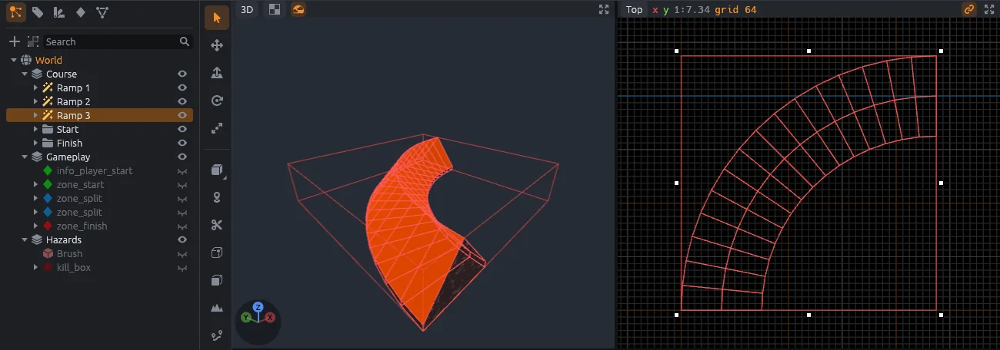
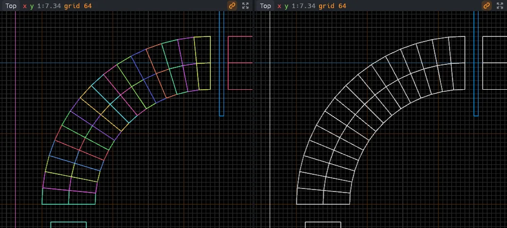
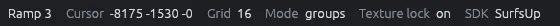

# Getting around

This page shows you how to find your way around a map: the four views, flying the 3D camera, the grid and snapping.
Once these feel natural, every other tool gets easier.
Keys here are from the MapCraft preset; the Hammer and TrenchBroom presets change some of them (see [Keyboard shortcuts](shortcuts.md)).

## The four views

MapCraft opens with four views of the same map: **3D** at the top left, **Top** at the top right, **Front** at the bottom left and **Side** at the bottom right.
The 3D view is a camera you fly around.
Top, Front and Side are flat 2D views, each looking straight along one axis, which makes them good for drawing and lining things up.

1. Click a view's name to turn it into a 3D, Top, Front or Side view, or into the [UV editor](materials.md#the-uv-editor).
2. Drag the gaps between the views, or the spot where they cross, to resize them.

The view under the pointer gets an orange outline.
Keys such as `Space` and the arrow keys act on that view.

Z points up in MapCraft, so the Top view looks down along Z:

| View | Across | Up | Looks from |
|---|---|---|---|
| Top | X | Y | above |
| Front | Y | Z | the +X side |
| Side | X | Z | the -Y side |

## Maximize

When you want a closer look, press `Space` to fill the window with the view under the pointer.
Press `Space` again to bring back all four.

1. The **Maximize** button at the right end of each view's header (four corners pointing out) does the same, as does **View > Maximize View Under Pointer**.

### One view layout

If you like working in one big view, as in TrenchBroom, turn on **View > One View Layout** (`Shift+Space`).
`Space` then steps to the next view (3D, Top, Front, Side), and the status bar names the one shown.
To bring back all four, press `Shift+Space` again, or click **Restore** in the header, where Maximize was.

## Go to Origin

**View > Go to Origin** (`Shift+Home`) frames the map's origin (0, 0, 0) in every view.

## Moving around a 2D view

- Scroll to zoom in and out around the pointer.
- Right drag or middle drag to pan.
- Double click to focus on the selection.
- The arrow keys nudge the selection one grid step.

Each 2D view's header shows:

1. Its two axes, its scale (map units per pixel) and the grid size.
2. The chain button for linked zoom.
3. The maximize button.

### Linked zoom

While zoom is linked, zooming one 2D view zooms them all to the same scale, so they stay easy to compare.
It is on by default.
Toggle it with `Shift+Z`, the chain button, or **View > Link 2D Zoom**.

## Flying the 3D camera

The 3D camera flies like a spectator in a game: hold the right mouse button to look around, and use `W`, `A`, `S` and `D` to move.

| Do this | To |
|---|---|
| Hold the right button and move the mouse | Look around |
| Hold the right button and press `W`, `A`, `S`, `D` | Fly forward, left, back and right |
| Hold the right button and press `Q` or `E` | Sink or rise |
| Add `Shift` while flying | Fly three times as fast |
| Scroll while flying | Fly faster or slower |
| Hold `Alt` and the right button and move the mouse | Orbit the point under the pointer |
| Scroll while orbiting | Move nearer or farther |
| Middle drag | Pan |
| Scroll | Move forward or back |

An orbit turns around the surface you pressed on, or around a point ahead of the camera when there is none, and keeps its distance as it turns.

While the right button is down, single keys only fly; shortcuts with `Ctrl` still work.

The fly speed starts at 512 units per second.
The status bar shows it while you change it, and **Edit > Preferences** (`Ctrl+Comma`) sets it too.

### The axis widget

The bottom left corner of each 3D view shows which way X (red), Y (green) and Z (blue) point.
Click an axis to look along it at whatever is in the middle of the view.
Click it again to look from the other end.

## Render modes

The 3D view can draw the map in four ways, from full materials down to bare edges.
Press `Z` to step through them.
You can also pick one from the mode menu in the 3D view's header (its icon shows the current mode), or from the **View** menu.

| Mode | Key | Shows |
|---|---|---|
| Textured | `Ctrl+Alt+1` | Faces with their materials |
| Flat Shaded | `Ctrl+Alt+2` | Faces without materials |
| Wireframe | `Ctrl+Alt+3` | Edges only |
| Lit | `Ctrl+Alt+4` | Materials lit by the map's lights |

Every 3D view uses the same mode.
2D views always draw edges.

### Lit

Lit shows you roughly how your lighting and materials will look, without compiling the map.
Faces take light from the map's lights, spotlights and sun, with normal maps and shine from the materials.

- A map with no lights gets a stand-in warm sun and cool fill light, so materials still show.
- Quake lights shade the way the game's compiled lighting looks, with bright pools near lights and darker corners.
- A `light_environment` with the Godot sky keys draws the same sky and sun the MapCraft Godot addon builds, so you can tune them in the inspector.
- Nothing casts shadows, and fog is not shown.

A material's normal, roughness, metallic and occlusion maps are found from their file names, such as `Bricks_NormalGL.png` or Poly Haven's `bricks_rough_1k.jpg` beside `bricks_diff_1k.jpg`, and they are not listed as materials of their own.
To change them, pick the material and open **Lit maps** in the Materials panel:

- each map's list offers the pictures in the material's folder, **Found automatically** or **None**;
- **Roughness** and **Metallic** multiply their map, or stand alone when there is none;
- **Reset** goes back to what was found.

Your choices are kept for every map on that SDK.

> [!NOTE]
> The light keys Lit reads, the sky keys and where material maps come from are in [Lit preview](../lighting.md).

### Sky

The **Sky** button in the 3D view's header, right after the render mode menu, shows and hides the sky.
**View > Show Sky** does the same.
Every 3D view follows the setting, like the render mode, and MapCraft remembers it.

With the sky hidden:

- Lit draws no sky behind the map.
- Sky faces, such as Quake's `sky` textures, draw like other faces instead of showing the sky beyond them.
  A Quake sky shows its back layer, stretched.
- With baked lighting in Lit (see [Baked lighting](../sdk-format.md#baked-lighting)), sky faces keep showing the sky, and only the sky behind the map goes away.
- The lighting stays the same.

Flat and Wireframe draw no sky, so the button is grayed out there.

## Framing

When you lose track of where you are, framing brings the camera back to something useful.

- `Home` (**View > Frame All**) fits the whole map in every view.
- `F` (**View > Focus Selection**) fits the selection, or the whole map when nothing is selected.
- Double click a row in the Scene panel to select it and focus on it.

2D views zoom to fit.
The 3D view keeps its angle and backs away until the target fits.

## Grid size

The grid keeps what you draw and move lined up.
It is 16 units by default, and MapCraft remembers your choice.

- `[` halves it and `]` doubles it, from 0.125 up to 4096 units.
- The **Smaller grid** and **Larger grid** buttons (a fine grid and a coarse grid icon) on either side of the grid size on the top bar do the same.

When a 2D view is zoomed far out, it draws a coarser grid and shows that size in orange in its header.
Drags in that view snap to the coarser grid; zoom in to snap finer.

## Snapping

Snapping makes dragged points land exactly where you want them.
Both snapping switches sit on the top bar and are on by default.

- **Snap** (`Shift+W`), the magnet, puts dragged, drawn and placed things on the grid, and turns rotations in 15 degree steps.
- **Corners** (`Shift+Q`), the square with a dot on each corner, snaps a point dragged in a 2D view to a nearby brush corner or entity origin.

While you drag, an orange cross marks the grid point you will land on, and a yellow ring marks a snapped corner.
When you move a selection, the corner nearest where you grabbed it is the one that snaps.

> [!TIP]
> To put objects that are off the grid back on it, use **Tools > Snap Selection to Grid** (see [Tools](tools.md#brush-operations)).

## Map limits

Some games limit how far a map may reach, such as Quake's -4096 to 4096 on every axis.
When the SDK sets a limit, the 2D views outline it in red.
**Tools > Check for Problems** (`Alt+P`) reports anything that reaches past it, since the game would fail on it.

## Hide, isolate and show

Hiding things gets them out of your way while you work on what is behind them.

| Command | Key | Does |
|---|---|---|
| **View > Hide Selected** | `H` | Hides the selection |
| **View > Isolate Selected** | `I` | Hides everything outside the selection |
| **View > Show All** | `U` | Shows everything again |

The eye on each row of the Scene panel hides or shows that one thing.
Hidden things cannot be clicked or snapped to.
Hiding is an undo step like any edit.
Tags and cordons hide whole sets at once (see [Organizing](organizing.md)).

## Color by object

**View > Color Brushes by Object** (`Ctrl+Alt+C`) gives the edges of each brush a color of its own, so neighboring brushes are easy to tell apart.
It is on by default and shows in the 2D views and in Wireframe.
Brushes inside an entity keep the entity's color, and selected edges keep the selection color.

## Color by slope

**View > Color by Slope** (`Ctrl+Alt+5`) tints every face by how steep it is.
A floor too steep to stand on, or a ramp too flat to surf, shows at a glance.

| Color | Face |
|---|---|
| Green | Walkable: no steeper than 45.573 degrees, Source's limit for standing |
| Blue | Surfable: steeper than walkable, up to 72 degrees |
| Orange | Wall: steeper still |
| Purple | Ceiling: facing down |

The tint shows in Textured, Flat and Lit; Flat shows it plainest.
Displacements are colored triangle by triangle, and tool brushes such as triggers keep their own color.

> [!TIP]
> Change the limits with **Color by Slope** in **Edit > Preferences**.
> Surf maps' main ramps measure 47 to 64 degrees, and staying a degree or two over 45.573 keeps a ramp surfable.

## Leak trails

A leak is a gap in the map's outer shell that lets the inside reach the empty void around it.
When a compile finds one, vbsp writes a `.lin` file and qbsp a `.pts` file: a line from inside the map out to the void.
After a compile, MapCraft loads the trail it finds beside the map or in its `build` folder and draws it in red in every view.

- **Run > Next Leak Point** (`Period`) puts the 3D camera on the next point of the trail, looking along it, and centers the 2D views there.
- **Run > Previous Leak Point** (`Comma`) steps back.
- **Run > Unload Leak Trail** hides it; opening another map or starting a compile does too.
- **Run > Load Leak Trail** loads one by hand.

Follow the trail to where it leaves the map and close the gap there.

## The status bar

The bottom bar shows what is selected, where the pointer is in a 2D view, the grid, the selection mode, texture lock and the SDK, each behind its icon.
On the right it shows a hint for the current tool, or a message for a few seconds.
The **Output** button at the far right (a terminal window icon) shows or hides the Output panel.

