# Tutorial: your first room

Never made a map before?
This tutorial starts from nothing and ends with a small room you can walk around in, one step at a time.
It takes about 20 minutes, and you will use the same few moves on every map you make.

The orange numbers on each picture match the numbered steps.

## Words you will meet

- **Map:** the level you build, saved as a `.mcmap` file.
- **Brush:** a solid block shape.
  Floors, walls and ramps are all brushes.
- **Entity:** anything the game reads that is not a wall, such as a spawn point, a zone or the sun.
- **Material:** the picture painted on a face of a brush, also called a texture.
- **SDK:** tells MapCraft about one game: its entities, its materials and how to play the map.
- **Unit:** MapCraft's measure of length.
  One unit is one inch, so a meter is about 39 units.

## 1. Start a new map

MapCraft learns each game from an SDK, and the first time it starts it has none, so the **Add an SDK** window opens.

1. Click **Install…** on the **SurfsUp** card, then **Install**.
2. Wait for it to download.

MapCraft starts a new map on SurfsUp and opens **SDK Settings**; [Tell it where your game is](#tell-it-where-your-game-is) shows what to fill in.

If SurfsUp is already installed, start the map yourself:

1. Choose **File > New Map** (`Ctrl+N`).
2. Pick **SurfsUp** in the SDK list.
3. Click **Create**.

If your current map has unsaved changes, MapCraft asks whether to save them first.

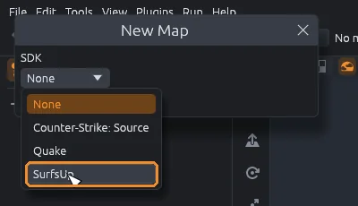

### Tell it where your game is

The SurfsUp SDK brings its own materials, and takes the rest of the game's textures from your SurfsUp Godot project.
**SDK Settings** opens right after the install, and again by itself until MapCraft knows where that project is.

1. Click **Browse** next to **SurfsUp Godot project folder** and pick the project folder.
2. Click **Apply**, or close the window.

A path that does not exist turns red.

> [!NOTE]
> The other folders are only needed to play the map and to import BSP maps.
> You can fill them in later with **File > SDK Settings** (`Ctrl+Shift+Comma`).

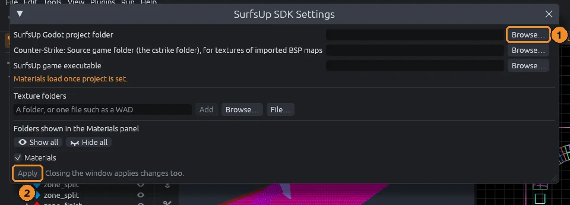

## 2. Find your way around

MapCraft shows the same map four ways at once.

- **3D** is a camera you fly around, like a spectator in a game.
- **Top** looks straight down, like a floor plan.
- **Front** and **Side** look at the map from the front and from the side.

To move around:

- In the 3D view, hold the right mouse button and move the mouse to look around.
  Keep holding it and press `W`, `A`, `S` and `D` to fly.
- In the flat views, scroll to zoom and right drag to pan.
- Press `Space` to fill the window with the view under the pointer, and again to bring back all four.

> [!TIP]
> Lost? Press `Home` to frame the whole map in every view.

## 3. Set the grid

Everything you draw and move snaps to the grid, which keeps walls lined up without any fiddling.
The grid size is on the top bar.

1. Press `[` to halve the grid and `]` to double it.
2. Set it to **16** for this tutorial.

## 4. Draw a block

1. Press `B` for the Block tool.
2. In the Top view, drag a square about 512 by 512 units.
   Labels show the size while you drag.

Your first block is 64 units deep, so it starts out as a flat slab.

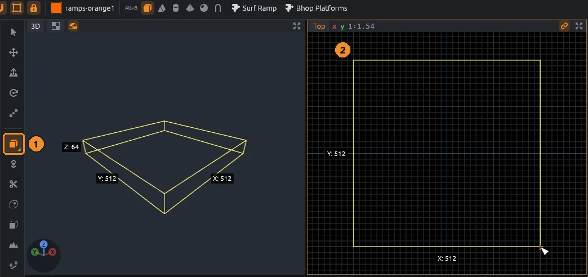

> [!TIP]
> Made a mistake? `Ctrl+Z` undoes it, and `Ctrl+Shift+Z` brings it back.

## 5. Make it taller

First press `Shift+L` to turn off texture lock (the padlock on the top bar).
With it on, textures stretch along with the block, and the materials you paint later would come out stretched too.

1. Press `Q` for the Select tool.
2. In the Front view, drag the white handle on the block's top edge upward until the label reads 256.

The side you drag turns red, and the opposite side stays put.

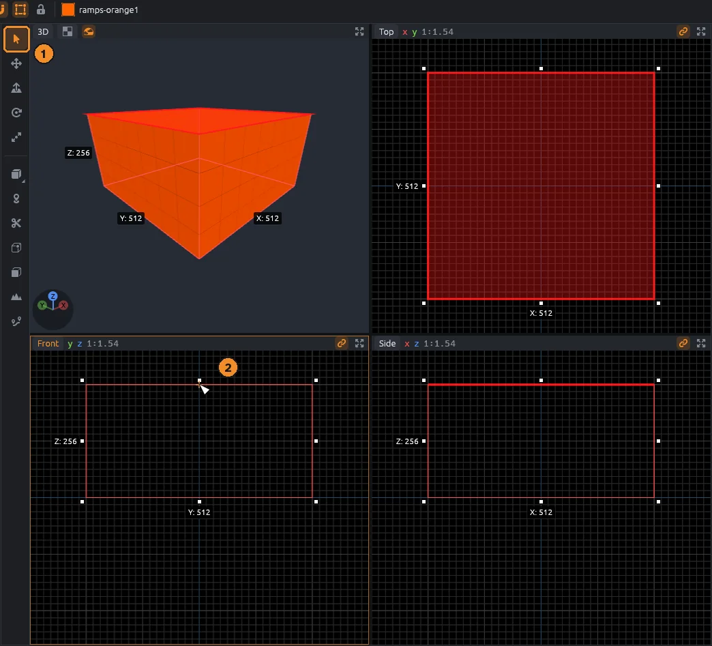

## 6. Hollow it into a room

A room is a solid block with its inside taken out.
MapCraft does that for you.

1. With the block still selected, press `Ctrl+H`, or right click it and choose **Hollow**.

The block becomes six brushes: a floor, a ceiling and four walls, each one grid step (16 units) thick, around an empty inside.

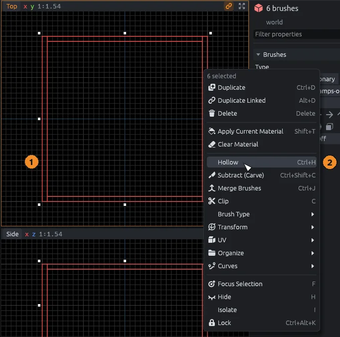

## 7. Look inside

The ceiling hides the room from the 3D camera, so hide the ceiling while you work.

1. In the 3D view, click the ceiling to select it.
2. Press `H` to hide it.

Now you can look down into the room.
Choose **View > Show All** (`U`) whenever you want everything you hid to show again.

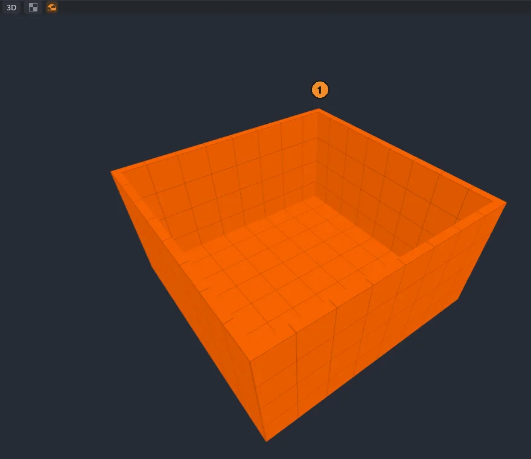

## 8. Paint it

1. Open the **Materials** tab (`Ctrl+3`).
2. Click the floor in the 3D view to select it.
3. Click a material: the floor gets it.
4. Ctrl+click the four walls to select them together, and click another material.

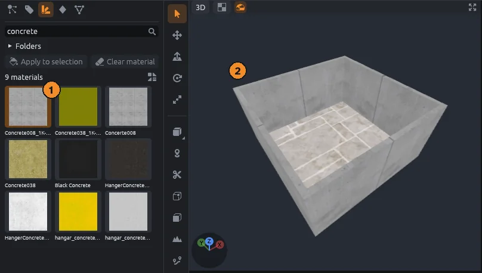

[Materials](../guide/materials.md) covers searching, painting single faces and lining textures up.

## 9. Add a spawn point

The spawn point is the entity that tells the game where the player appears.

1. Press `N` for the Entity tool.
   It starts out placing `info_player_start`, the spawn point.
2. Click on the floor in the 3D view.

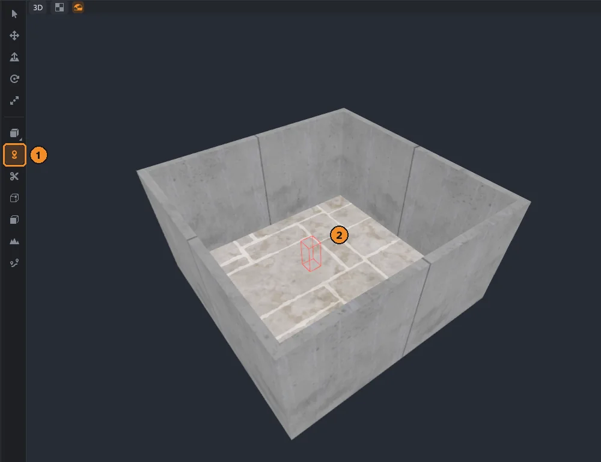

## 10. Add a sun and see it lit

A `light_environment` is the entity that gives your map its sun, sky and fog.

1. Open the **Entities** tab (`Ctrl+4`) and click `light_environment`.
2. Click on the floor in the 3D view to place it.
   Where it stands does not matter.
3. Press `Ctrl+Alt+4` with the pointer over the 3D view to switch it to **Lit**.

Lit shows your materials under the sun and sky, close to how the game will light them.

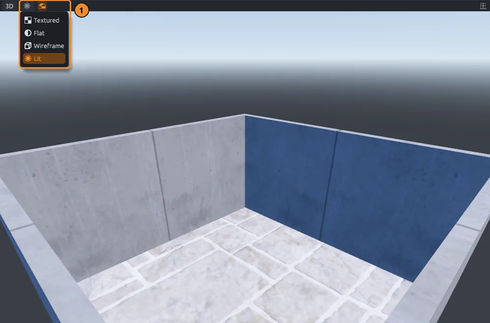

> [!TIP]
> Select the `light_environment` to change the sun's direction, the sky colors and the fog in the inspector.

Choose **View > Show All** (`U`) to show the ceiling again before you save.

## 11. Save

Press `Ctrl+S`.
The first save asks where to put the map; maps are `.mcmap` files.
The window title starts with `*` while there are unsaved changes.
To save a copy under a new name, use **File > Save As** (`Ctrl+Shift+S`).

MapCraft also keeps autosaves and backups for you; see [More about saving](#more-about-saving).

### Open it again

- **File > Open** (`Ctrl+O`) opens a map, and **File > Open Recent** lists the last ones you opened.
- Drag a `.mcmap` file from your file manager onto the MapCraft window to open it.
- Drag in any file a loaded plugin imports, such as a Quake `.map` or a Hammer `.vmf`, to add it to the open map as a new layer, as **File > Import** does.
- Drag in a `.glb` or `.gltf` file to add its meshes as brushes; see [Blender and glTF](../guide/gltf.md).

While you drag a file over the window, it dims and says what dropping will do.
A file MapCraft cannot open leaves the map as it is and says so in the status bar.
If the open map has unsaved changes, MapCraft asks whether to save them first.

## 12. Check for problems

MapCraft can look over your map for mistakes before you play it.
Press `Alt+P`, or click **Check** (the checklist icon) at the right of the top bar.
The Issues tab opens below the views, with errors in red and warnings in yellow.

- Click an issue to select the object and look at it.
- **Fix** (the wrench on an issue's row) repairs one issue.
  **Fix all** repairs every one it can, as one undo step.
- **Check again** runs the checks once more.

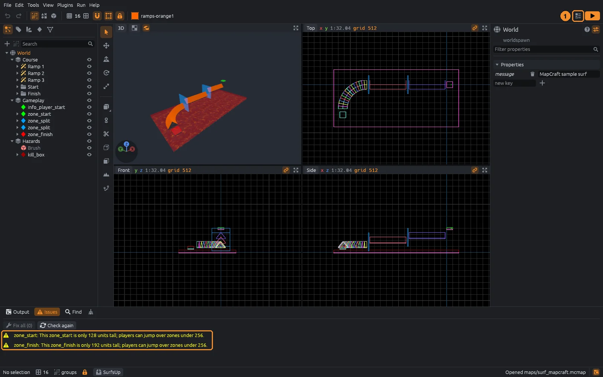

## 13. Play it

To play, set **SurfsUp game executable** in **File > SDK Settings** to the installed game; [Play it in Godot](../guide/godot.md) has the details.

Open the **Run** menu, or click the orange play button at the right of the top bar (**Compile and play the map**), and pick **Play in SurfsUp**.
It copies the map into the `Maps` folder next to the game, making the folder if it is missing, and starts the game on your map.

Running saves the map first.
The first time, MapCraft asks **Run this SDK's programs?**; click **Allow** if you trust the SDK.
Progress shows in the Output panel.
After that, `F9` runs the last profile again, and `Shift+F9` stops it.

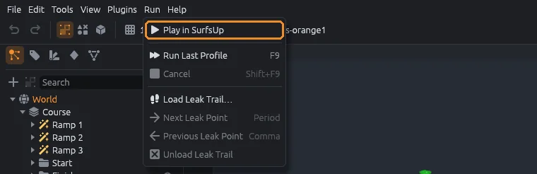

## More about saving

### Autosave and crash recovery

While you have unsaved changes, MapCraft saves a backup every 5 minutes.
If MapCraft closes without saving, the next start asks **Recover unsaved work?**:

- **Open** loads the backup as an unsaved map.
- **Delete autosaves** throws the backups away.
- **Not now** keeps them for later.

To change the interval, set **Autosave every** in **Edit > Preferences**; 0 turns autosave off.
Saving the map, or quitting normally, deletes its autosave.

> [!NOTE]
> Autosaves wait until you finish a drag, so they never catch half a move.
> They live in the `autosave` folder of MapCraft's data folder: `~/.local/share/mapcraft/autosave` on Linux, `%LOCALAPPDATA%\mapcraft\autosave` on Windows.
> Each map gets its own autosave, named for the map and its folder, so two maps called `level.mcmap` in different projects never overwrite each other's.
> Each running MapCraft keeps its own autosaves too, so a second window never offers back or deletes the first one's.

### Backups and Revert

Each save first copies the file it replaces into a `backups` folder beside the map.
`level.1.mcmap` is the version before the last save, and `level.2.mcmap` the one before that.
To get an earlier version back, open a backup like any map.

**Keep backups** in **Edit > Preferences** sets how many are kept (3 to start with); 0 turns them off.
Saving a map that has not changed since its last backup makes no new one.
The `backups` folder holds a `.gdignore` file, so Godot does not import the copies as scenes.

**File > Revert** throws away unsaved changes and opens the saved map again, after asking.

**File > Reload Assets** (`F5`) rereads the SDK's entity definitions, materials, models and prefabs from disk.
It keeps the map, the selection, the undo history and the current material.
Use it after editing an FGD (the file that lists a game's entities) or a texture with the map open.

## Where next

You now know the moves most maps are made of: draw, resize, hollow, paint and place entities.

- [Surf ramps and bhop](../guide/surf.md): add surf ramps and bunny hop platforms that rebuild when you change their settings.
- [Entities and zones](../guide/entities.md#zone-from-selection): fit start and finish zones to your platforms so the timer runs.
- [Getting around](../guide/views.md): every camera control, render modes and snapping.
- [Tools](../guide/tools.md): every tool, from clipping to bevels.
- [Keyboard shortcuts](../guide/shortcuts.md): all the keys, and the Hammer and TrenchBroom presets.
